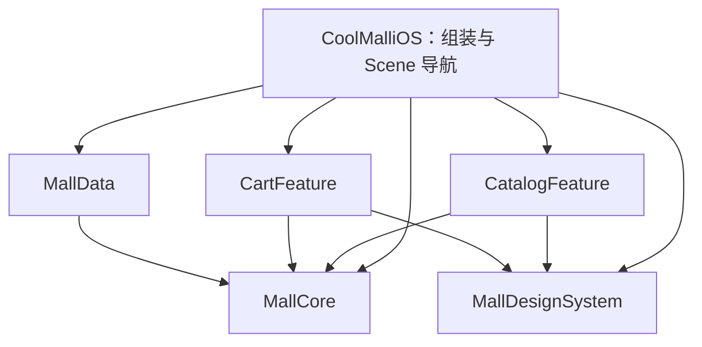

# CoolMall iOS 项目工程手册

更新日期：2026-11-04。适用范围：以 CoolMallKotlin 的业务和接口为参考的原生 iOS 客户端。

本手册是架构决策、基础能力选型、代码规约、开发流程和验收要求的统一维护入口。

**当前状态：首页、分类/详情/评价、购物车、账号相关页面、订单/结算和搜索的既有代码已合入main，维护者已完成本轮手动验收。共享工程、Scheme/Test Plan、依赖锁及本地工程检查入口随仓库保留。远端CI关闭；Evidence及旧备份已于2026-11-04按维护者决定删除，不能再依赖其中资料；iOS17、真机和发布覆盖仍按第8章保留实际限制。** 新成员入口见README；当前策略见7.4，实际交付范围见第8章。

先阅读第 1—3 章理解方向与边界；实现页面先查 [2.5 MVVM 合同](#25-feature-内部的-mvvm-合同)；开发基础能力时查第 4—6 章；执行构建与检查时查第 7 章；具体开工顺序见 [8.4](#84-接下来如何开工)。

## 目录

- [1. 项目定位与技术基线](#1-项目定位与技术基线)
- [2. 架构与状态管理](#2-架构与状态管理)
- [3. 模块、目录与编译边界](#3-模块目录与编译边界)
- [4. 基础设施与公共组件](#4-基础设施与公共组件)
- [5. 代码规约与依赖管理](#5-代码规约与依赖管理)
- [6. 测试与验收标准](#6-测试与验收标准)
- [7. 开发流程、构建与 CI](#7-开发流程构建与-ci)
- [8. 实施计划与当前状态](#8-实施计划与当前状态)
- [9. 官方参考与手册维护](#9-官方参考与手册维护)

## 1. 项目定位与技术基线

### 1.1 原生 SwiftUI 与架构原则

**已确认的开发方案：按业务功能模块化 + 页面按需使用 MVVM + SwiftUI 组件组合复用 + 协议注入数据能力。** 使用 Observation 和 Swift Concurrency 落实状态观察与并发；第 3 章的 Target 边界、第 2 章的状态所有权仍然有效。

复用 Android 项目的业务知识、接口协议，以及已验证有效的职责分离、单一事实源、依赖隔离和测试方法。iOS 适配重点是 SwiftUI 视图身份、对象所有权、任务生命周期和系统交互。MVVM、Repository、组件化都可用于原生 iOS；无需为了“原生”更换这些设计思想。

Apple 提供状态管理、导航、持久化和并发机制，并未在这里引用的官方指导中要求每个 App 使用 MVVM、Repository 或 Clean Architecture。本项目的模块名称和依赖限制属于工程决策，不标为“Apple 官方架构”。

#### 官方机制与可选模式

| 名称 | 来源、用途 | 本项目用法 |
| --- | --- | --- |
| `@State` | SwiftUI 属性包装器，保存由视图管理的状态 | 局部状态、视图拥有的可观察模型 |
| `@Binding` | SwiftUI 属性包装器，访问由其他位置拥有的值 | 子视图编辑父级值，不额外创建一份状态 |
| `@Bindable` | SwiftUI 属性包装器，为可观察对象属性产生 Binding | 表单需要 `$model.property` 时使用 |
| `@Observable` | Observation 框架的宏 | 有需要时定义可观察模型；它不是线程安全或持久化机制 |
| `@Environment` | SwiftUI 的环境访问机制 | 传递共享会话、购物车等 UI 依赖；必需对象在应用入口和预览中注入 |
| ViewModel | 通用设计模式，不是 Swift 标准库或 SwiftUI 必须继承的类型 | 不要求每个 View 配一个；有页面协调职责时统一使用 `<页面名>ViewModel`，如 `ProductListViewModel`；适用条件见 2.5 |
| Repository | 通用数据访问模式，不是 Swift 内置类型 | 需要统一同一业务数据的缓存/远端/持久化策略时采用；单一来源先用具体能力实现，不并列创建同职责 Service 和 Repository |
| Use Case | 通用业务编排模式，不是 Apple 必选层 | 结算等复杂流程出现时再提取，不为简单转发创建空壳类 |

使用模式本身不会损害原生优势。判断依据是是否遵循 SwiftUI 的状态生命周期、系统交互和并发规则，而不是类型名称是否包含 ViewModel。把 ViewModel 改名为 Model 但保留无意义层次，也不是改进。

参考：[Apple Model Data](https://developer.apple.com/documentation/swiftui/model-data)、[Binding](https://developer.apple.com/documentation/swiftui/binding)、[Bindable](https://developer.apple.com/documentation/swiftui/bindable)、[Managing model data](https://developer.apple.com/documentation/swiftui/managing-model-data-in-your-app)。

### 1.2 平台与工具链基线

- 新工程暂以 iOS 17 为最低版本，便于统一使用 Observation。该版本是项目建议，不是 Apple 对所有 App 的要求；产品覆盖范围确定后再调整。
- 使用 Swift 6 语言模式，显式管理 actor 隔离和跨隔离域传值。编译器版本、语言模式、SDK 版本、最低系统版本是不同概念。
- 本地工程入口固定使用 Xcode 27.0（27A266a）、Swift 6.4，通过 `Scripts/check-toolchain.sh` 校验完整版本。formatter 的版本输出为 `main`，因此同时校验所属 Xcode build 和 Swift 编译器完整版本。远端CI当前停用，不把旧执行器或历史结果当成本轮运行证据。
- 本机 SDK 为 iOS 27.0，模拟器 runtime 可使用已安装的 iOS 26.2。SDK 决定编译时可见的系统接口，deployment target 决定 App 支持的最低系统，runtime 是实际运行系统；三者不必同版本。设为最低 iOS 27.0 的 App 无法在 iOS 26.2 上运行。当前只按用户要求切换验证设备，不将测试设备版本当成修改最低支持范围的授权；提高最低版本须同步 App、Package、手册和检查器。[Apple 构建设置定义](https://developer.apple.com/library/archive/documentation/DeveloperTools/Reference/XcodeBuildSettingRef/1-Build_Setting_Reference/build_setting_ref.html)
- 新代码采用 Observation；只有最低版本或现有依赖要求时才选择 `ObservableObject`。不为追求“纯新 API”重写兼容性所需代码。

### 1.3 模块化、MVVM 与组件化的关系

| 设计维度 | 要回答的问题 | 本项目决定 |
| --- | --- | --- |
| 功能模块化 | 商品、购物车、账号等能力之间怎样隔离实现和依赖？ | Feature Target 隐藏内部实现；通过 Core 能力和 App 组装协作 |
| MVVM | 一个页面的展示、动作、状态转换与业务能力怎样分工？ | 有页面协调职责时采用 View + ViewModel；业务合同/规则和数据实现按 2.1 分布 |
| UI 组件化 | 页面如何组合控件，共性怎样复用？ | SwiftUI View、ViewModifier、ButtonStyle；用值/Binding/动作闭包提供小接口 |

三者可以同时成立。一个 Feature 可以包含多个页面和各自的 ViewModel，每个页面再由组件组成；不因使用 MVVM 就建立全 App 共用的 Views/ViewModels 大目录，也不因组件可复用就立即给每个组件建立 Target。

当前采用“按功能隔离界面 + 共享业务合同与数据实现”的组合：Feature 是界面业务能力模块，不是每个功能都自带一套网络/数据库。MallCore、MallData 内仍按 Catalog/Cart 等业务归档；该选择属于本项目，不是 iOS 必须的目录规范。后续拆分严格按 3.6 的触发器执行。

| Android 常见机制 | SwiftUI 中相近的职责 | 不能直接等同的部分 |
| --- | --- | --- |
| Composable + 页面 ViewModel | SwiftUI View + 普通 Swift ViewModel | SwiftUI 没有要求继承 Jetpack ViewModel 的对应基类 |
| StateFlow + UI 收集 | Observation 跟踪视图读取的属性 | @Observable 不自动提供事件流、线程安全、持久化或任务作用域 |
| ViewModelStoreOwner 管理存活范围 | 明确的 View/Scene/App 所有者；需要时用 @State 保存视图拥有的可观察对象 | SwiftUI 的视图身份不能按 Android 配置变化生命周期机械推导 |
| 参数 + onValueChange | 值 + 动作闭包，或合适的 Binding | Binding 是读写通道，不自动校验业务或建立新事实源 |
| viewModelScope 等任务管理 | .task/.task(id:) 或明确的任务持有者 | @Observable 本身不会自动取消模型启动的 Task |

Android 与 iOS 复用的是设计思想和业务合同；具体 API、任务取消和对象生命周期分别按平台实现。这里的对照不代表逐行转换关系。官方依据：[Android 架构建议](https://developer.android.com/topic/architecture/recommendations)、[Android ViewModel](https://developer.android.com/topic/libraries/architecture/viewmodel)、[Apple 模型数据管理](https://developer.apple.com/documentation/swiftui/managing-model-data-in-your-app)。

## 2. 架构与状态管理

### 2.1 模块职责与依赖组装

**决定：第一条商品→购物车链路就建立 Feature Target 隔离，取消原方案的单一 MallUI Target。** 一个本地 Swift Package `MallKit`，首期五个生产库 Target；IMAGE-01按批准新增第六库MallImages，ACCOUNT-LOGIN-01按批准新增第七库AccountFeature；ORDER-V1按用户批准新增OrdersFeature/CheckoutFeature及对应测试，加一个 App Target。不是每个页面一个 Package，也不提前建立空的账号、订单和支付模块。决策依据、代价和后续拆分触发器见第 3 章。

| 模块 | 拥有内容 | 允许的直接项目依赖 | 不允许承担 |
| --- | --- | --- | --- |
| `MallCore` | 商品、金额、购物车快照等业务值；纯规则；`ProductLoading`、`CartCommands`、`CartObserving` 等窄能力协议 | 无 | SwiftUI、HTTP DTO、数据库模型、导航、全局可变容器 |
| `MallData` | APIClient、DTO 映射、存储适配、CartStore、SessionCoordinator；业务能力的真实实现 | MallCore | 页面、展示模型、导航和提示文案 |
| `MallDesignSystem` | 设计语义、无业务依赖的控件和展示组件 | 无 | 商品/订单实体、业务服务、会话、购物车单例 |
| `CatalogFeature` | 首页商品入口、分类/搜索、商品列表与详情；页面模型和专用组件 | MallCore、MallDesignSystem、MallImages | CartFeature 内部模型、MallData、HTTP/数据库/凭据 API |
| `CartFeature` | 购物车页面、编辑交互、只读快照投影 | MallCore、MallDesignSystem | 自建第二个购物车事实源、CatalogFeature、MallData |
| `AccountFeature` | 我的静态展示、登录表单、只读个人中心与退出意图 | MallCore、MallDesignSystem、MallImages | Keychain/通知/网络副作用、其他 Feature、第二会话事实源 |
| `OrdersFeature` | 订单列表/详情、待付款取消意图及页面状态 | MallCore、MallDesignSystem、MallImages | 自行HTTP/裁决状态、支付、会话事实、其他Feature/数据层 |
| `CheckoutFeature` | 确认草稿、地址/券/备注/创建意图及只读收银台 | MallCore、MallDesignSystem、MallImages | 自行HTTP/支付、最终金额裁决、存储副本、其他Feature/数据层 |
| `MallImages` | 图片管线、缓存与RemoteImage薄包装（IMAGE-01） | 精确Nuke/NukeUI13.2.0 | 业务HTTP/会话/商城凭据、商品事实源 |
| `CoolMalliOS` App | 依赖创建与生命周期、Scene 根导航、跨功能路由、系统回调、根 UI 投影 | 上述九个库 | 业务规则、逐页实现、自己执行数据库事务 |



箭头是允许的直接编译依赖。Feature 之间无依赖边。公共入口接受 Core 合同和用户动作回调；具体 ViewModel、子页面、DTO 保持 internal/private。App 创建同一个 CartStore，把命令/观察能力分别注入商品页、购物车页和角标投影。商品页“加入购物车”调用 `CartCommands`，不 import CartFeature，也不通过通知广播猜测状态。打开购物车由 App 处理导航意图。

`ProductListViewModel` 接收 `any ProductLoading`，App 注入 HTTPProductService 或测试替身。需要缓存策略时才增加 Repository；不为简单调用强制增加空壳 Use Case。APIClient 只留在数据层。Core 协议按消费者所需能力拆分，不提供能任意查询所有服务的 Service Locator。

平台 SDK 需要 UIKit 展示上下文时，由 App 的桥接层提供；Core 合同不出现 UIViewController。第三方适配的 Target 触发条件见 SPLIT-03。Environment 只传递视图树依赖，不向所有页面暴露 AppDependencies 或任意服务查找器。

### 2.2 状态所有权与 SwiftUI 示例

“所有者”是**有权提交该状态的新版本的对象**，不等于任何持有副本的 View。读取者可以有只读快照，但不能另起一套写入路径。下表是首期业务合同；F0 只实现 fixture 模型和内存 fake，业务对象的实际状态见 8.3。

| 状态 | 唯一写入权与创建位置 | 生命周期/隔离 | 其他位置及冲突处理 |
| --- | --- | --- | --- |
| 弹窗、焦点、展开项 | 最近的 View | 视图身份；主线程 | @State/@FocusState；子组件用 Binding，不双向复制 |
| 查询、列表、页码、加载/错误 | CatalogFeature 的 ProductListViewModel（按搜索/列表实例） | 页面实例、@MainActor | 子 View 只读/发动作；query + generation + requestID 验证响应 |
| 已提交购物车内容 | MallData 的 CartStore，由 App 组装一次 | 按 environment + accountID/guest 分区；actor 或等价串行写入机制 | CartViewModel/角标只是只读投影；持久化成功后发布带 revision 的快照；失败保留上次提交值 |
| 会话事实、凭据及刷新中的任务 | MallData 的 SessionCoordinator，协调 CredentialStore/Keychain | 应用会话；actor；sessionGeneration | App 的 SessionViewModel/Feature 的会话投影只订阅；登录/退出/刷新都经统一命令；旧 generation 不可回写 |
| 导航栈、选中 Tab、跨 Feature 弹层 | App 的 SceneRouter | 每个 Scene，@MainActor | Feature 发类型化意图/回调；不持有其他 Feature 的 ViewModel |
| 表单草稿/未提交购物车编辑 | 当前 Feature 的编辑模型 | 一次编辑会话，@MainActor | 明确为草稿；保存成功更新事实源，取消丢弃；不谎报持久化成功 |
| 订单状态、价格核算、支付结果 | 服务端 | 请求结果按订单 ID 和会话校验 | 客户端缓存/支付 SDK 回调不作为最终订单事实，主动查询确认 |
| 网络/图片缓存、数据库记录 | 对应数据适配器 | 分区、有效期、清理机制明确 | 缓存是恢复/性能副本；账号切换不能污染新会话 |

共享的是合同与事实源，不是跨 Feature 共享具体 ViewModel。CartFeature.CartViewModel 与 App.CartBadgeViewModel 可以各自订阅同一个 CartObserving；它们都不能独立写数组再反向同步。购物车总数/合计从同一 revision 快照派生，不另设可写计数器。若首次展示需要当前值，观察接口必须保证“初始快照 + 后续事件”之间不丢更新，并测试订阅、重连和销毁。

#### 状态规则与触发条件

| 规则 | 何时触发 | 必须完成的动作与验证 |
| --- | --- | --- |
| STATE-01 单一写入权 | 新增可变状态；已有局部状态出现第二个消费者；新增缓存/持久化副本 | 在类型说明或 PR 状态合同中写清所有者、分区键、生命周期、写命令、只读投影和冲突决定权；未说明不合并。跨 Feature 共享必须由 App 注入同一事实源，不能扩大 Feature ViewModel 的访问权限 |
| STATE-02 事件合同 | 新增异步操作或改变任何加载/保存/提交状态转换 | 列出 idle/loading/success/empty/failure 等实际状态、事件和非法转换；至少测成功、失败以及本次引入的取消/竞争分支；多个 bool 不能表示自相矛盾的并行状态 |
| STATE-03 await 后提交 | 请求存在替换查询、刷新、退出、切换账号或重复提交的任一可能 | await 前记录 generation/requestID，提交前再次确认；actor 仍会在 await 处重入，不能把 actor 当成整段异步事务；用可控 fake 反序返回测试 |
| STATE-04 生命周期 | 创建 Task、订阅、通知观察或流 | 明确谁持有、何时取消/移除、错误归谁；页面离开和账号切换各有处理；若操作必须跨页面继续，由相应长生命周期服务持有并记录理由 |
| STATE-05 持久化一致性 | 新增/修改保存、删除、合并、迁移、恢复 | 存储提交成功后才发布已提交快照；测试磁盘重建、失败回滚、账号隔离；乐观 UI 必须独立 pending 状态和回滚合同 |
| STATE-06 权限与外部事实 | 新增系统权限、支付回调、恢复前台处理 | 重新读取系统/服务端事实；不得把本地 bool 或回调成功当永久授权/支付成功；验证拒绝、取消、外部改变 |

状态合同最小字段：`状态名 / owner 类型及 Target / scope 与 key / 隔离 / 写命令 / 读取者 / await 后校验 / 取消与销毁 / 持久化提交点 / 对应测试`。不存在的字段写“无，原因…”。小范围局部展开项可在 PR 中一句说明，不为每个 @State 建独立文件。新增共享事实源或改变写入权按 CHANGE-02 评审。

读取传入的 `@Observable` 对象属性并不一定需要 `@Bindable`。只有控件需要属性的双向 Binding 时才使用它。`@Bindable` 本身不负责创建或维持对象的状态所有权。

下面示例只演示绑定。SearchDraft 是可编辑草稿，没有异步加载或页面协调职责，因此不命名为 ViewModel；它也不是业务事实源。实际搜索请求由 ProductListViewModel 按查询合同处理：

```swift
import Observation
import SwiftUI

@MainActor
@Observable
final class SearchDraft {
    var query = ""
}

@MainActor
struct SearchFormView: View {
    @State private var draft = SearchDraft()
    @State private var inStockOnly = false

    var body: some View {
        Form {
            SearchField(draft: draft)
            StockFilter(isEnabled: $inStockOnly)
        }
    }
}

@MainActor
private struct SearchField: View {
    @Bindable var draft: SearchDraft

    var body: some View {
        TextField("搜索商品", text: $draft.query)
    }
}

@MainActor
private struct StockFilter: View {
    @Binding var isEnabled: Bool

    var body: some View {
        Toggle("仅看有货", isOn: $isEnabled)
    }
}
```

有“保存/取消”的地址编辑页应编辑草稿，保存成功再更新共享数据；直接 Binding 到共享地址会让取消按钮失去撤销含义。

### 2.3 并发与副作用

- 驱动 UI 的可观察模型显式使用 `@MainActor`。Observation 只追踪变化，不保证互斥。
- 网络等待使用 `async/await`；它不保证同步 CPU 工作离开主线程。大型解码、图片处理等应按工具链隔离规则安排执行，并用测量验证。
- 网络、缓存的共享可变状态在有需要时使用 actor 或其他明确隔离方式，不把所有服务都机械标记为 MainActor。
- 跨隔离边界的数据定义正确的 Sendable 语义。不得用 `@unchecked Sendable` 或 `nonisolated(unsafe)` 掩盖设计问题。
- 与页面展示相关的任务可通过 `.task` / `.task(id:)` 管理。异步函数继续传播取消；服务忽略取消时，还需请求标识防止旧结果覆盖新状态。
- 取消操作不当作普通失败弹窗；缓存错误、解码错误和业务错误不统一吞掉返回空列表。
- 创建订单等非幂等操作不能盲目自动重试。客户端防重复点击与服务端幂等保障分别处理。

参考：[Swift Concurrency](https://docs.swift.org/swift-book/documentation/the-swift-programming-language/concurrency/)、[Swift 6 Data Race Safety](https://www.swift.org/migration/documentation/swift-6-concurrency-migration-guide/dataracesafety/)。

### 2.4 原生交互与系统集成

- 使用系统 TabView、NavigationStack、sheet、alert 和原生输入控件；有类型的路由优先携带 ID/必要值，不携带整个服务对象。
- 尊重返回手势、键盘、VoiceOver、Dynamic Type、深色模式和系统布局；不为了还原 Android 截图覆盖 iOS 的交互习惯。
- 优先 SwiftUI 组合。系统能力确需 UIKit 时，通过 Representable 等正式桥接机制接入。
- 图片资源、String Catalog 和 Swift Package 资源按所属模块管理，Package 内资源通过对应 Bundle 获取。
- SwiftData 不是使用 SwiftUI 的前提；本项目的存储选型和验证要求统一见 [4.8 本地存储](#48-本地存储不同数据使用不同合同)。
- Apple 示例中直接使用 `@Query` 是合理原生用法。本商城为了隔离远端协议和购物车缓存，计划将这些存储实现封装在 MallData；这是一项取舍，不是禁止使用 SwiftData。

### 2.5 Feature 内部的 MVVM 合同

本项目页面的基本流向为：`用户动作 → ViewModel → 注入的业务能力 → 结果/快照 → ViewModel 的页面状态 → View 渲染`。组件把动作交回页面，业务命令不通过任意可写 Binding 绕开 ViewModel/事实源。

| 角色 | 应做的事 | 不应做的事 |
| --- | --- | --- |
| View / 子组件 | 根据状态构造 UI、局部焦点/展开状态、发送用户动作、在明确生命周期入口 await 操作 | 在 body 计算中启动副作用；直接访问业务 HTTP/数据库；重算与服务不一致的交易规则 |
| ViewModel | 组织页面状态、处理加载/刷新/提交、把业务错误转换为展示状态；调用能力协议；维护请求有效性 | 持有 View/UIViewController；充当全局服务容器；自己保存 Token；把事实源复制成另一套独立可写数据 |
| 页面 State / Draft | 描述展示状态或可取消的编辑内容；按需要用 struct/enum/可观察草稿 | 当成数据库实体或服务端真相；与 ViewModel 同时各维护一套加载/错误状态 |
| Model 一侧的业务合同与实现 | Core 中的值/规则/能力协议；Data 中的数据访问与一致性策略 | 把 MVVM 的 Model 理解为“只需一个 JSON struct”，或让底层服务负责页面提示与跳转 |

**建立与拆分条件：**以下 VM 规则与 MOD/STATE 一样属于阻断规则，适用于新页面及行为改动的 PR；目前由审查和相应行为测试验证，不宣称清单脚本能检查这些职责。

| ID | 触发条件 | 合并前必须完成 |
| --- | --- | --- |
| VM-01 页面协调 | 页面首次需要业务异步加载/刷新/分页/提交，或跨多个控件协调业务状态 | 在所属 Feature 建立明确的页面 ViewModel，注入能力协议，并可脱离 SwiftUI View 测试成功/失败及相关竞争路径；只有静态展示或局部展开/焦点的 View 不强制建 VM |
| VM-02 对象生命周期 | 创建页面 VM、切换商品 ID/账号、保存或复用 VM 实例 | 标明谁创建、哪个页面身份拥有、何时更新/销毁。子 View 复用传入实例；不在 body 中反复创建，不假定初始化参数变化会替换已由 @State 保留的对象。身份变化时选定重建或显式更新，并撤销旧任务有效性 |
| VM-03 状态读写入口 | 新增可观察输出或双向绑定 | 请求结果、加载/错误、已提交快照对外只读（如 private(set)）；输入草稿可通过 Binding 编辑；提交、持久化和共享状态修改使用动作。无需把所有属性塞进单个万能 UiState，但互斥状态须避免非法组合 |
| VM-04 页面职责扩张 | 同一 VM 开始承担两个可独立进入、拥有独立任务/状态的页面 | 拆成各页面 VM，提取确实共享的合同/机制；列表与详情不能共用一个包揽全部状态的 VM。单个编辑流程内多个子视图可共享一个 VM，不为每个控件配 VM |

ViewModel 默认 `@MainActor @Observable final class`，名称如 ProductListViewModel、ProductDetailViewModel、CartViewModel；实现及初始化默认 internal。Feature 的 public 入口接收协议/初始 ID/导航回调，在内部创建所需 VM，App 不必知道内部 VM 类型。@MainActor 管理 UI 隔离，不保证 await 跨越期间状态不变；沿用 STATE-03。

页面相关读取通过 `.task` / `.task(id:)` await 可取消操作；不能在被 await 的方法中另开未管理 Task 让其提前返回。按钮触发的任务若由 VM 保存句柄，则要声明取消和销毁路径，避免任务与所有者互相长期持有。需要跨页面继续的操作交给适当服务持有。具体规则只在 2.2/2.3 定义，不另造一个统一 BaseViewModel 生命周期框架。

**Repository / Use Case 的提取条件：**

- 一个能力只有直接远端查询时，HTTPProductService 实现 ProductLoading 即可；ViewModel 不依赖这个具体类型。
- 同一业务能力开始协调本地与远端、缓存失效、离线写入或来源冲突时，在 Data 增加明确的 Repository；原消费者继续依赖窄协议。原实现若只是同职责转发，应合并或降为内部数据源，不并排维护两套策略。CartStore 已履行购物车事实源职责时，不再为命名完整加空壳 CartRepository。
- 一段操作要按业务顺序协调多个能力、包含补偿/幂等规则，并且需要独立测试或被第二个入口复用时，提取具体 Use Case。只依赖 Core 合同的纯业务编排可在 Core；包含具体 I/O 机制的部分留在 Data；页面提示留在 Feature。简单一次转发不单独建 Use Case。
- ViewModel 测页面状态；Core 测纯业务规则；Data/Repository 测来源策略和保存一致性；UI 测操作和渲染。测试归属与对象职责对应，验收场景引用第 6 章。

## 3. 模块、目录与编译边界

### 3.1 调研结论与当前取舍

Apple 明确支持用本地 Package 组织模块；Swift 的 internal 访问范围是模块，文件夹没有此效果，package 则允许同包跨模块访问。[Apple 本地 Package](https://developer.apple.com/documentation/xcode/organizing-your-code-with-local-packages)、[Swift 访问控制](https://docs.swift.org/swift-book/documentation/the-swift-programming-language/accesscontrol/)

成熟开源 App 也使用业务模块。例如 IceCubes 的 Timeline 有单独的 Package/Target，依赖 Models、DesignSystem 等，并配置独立测试。它证明这种组织可用于实际应用，但它的具体依赖图、iOS 版本和模块数量不直接作为商城规范。[Timeline 清单](https://github.com/Dimillian/IceCubesApp/blob/main/Packages/Timeline/Package.swift)

| 方案 | 收益 | 代价/风险 | 本项目决定 |
| --- | --- | --- | --- |
| MallUI 一个 Target，Feature 仅文件夹 | 入口和资源管理简单，内部重构方便 | 任意同模块文件能访问 internal；跨功能耦合只能靠审查，后期拆分需收缩已扩散的引用 | 不采用。当前尚无业务代码，且商品与购物车已有明确不同状态职责 |
| 一个本地 Package，按业务能力建 Target | 编译器隐藏实现；依赖和测试归属明确；同仓库原子修改合同与调用者 | 要设计少量 public 入口、资源 Bundle、测试依赖和组装；过度拆分会产生转发接口 | **采用：五个首期库 Target，后续按 3.6 的确定事件扩展** |
| 每页一个 Package/Target | 更细可见性 | 页面切换和共同模型产生大量接口；清单/资源/测试维护成本高；不保证编译更快 | 不采用。列表/搜索/详情同属 CatalogFeature，内部文件夹即可 |
| 多仓库/独立发布所有功能 | 独立版本与交付 | 跨库联调、版本兼容和发布协调成本 | 无独立交付需求，暂不采用 |

以上是针对本项目的工程判断，不是 Apple 强制的 MVVM/模块数量，也不承诺拆分必然提升构建速度。性能是否改善需用同一机器、工具链、干净/增量场景实测。

2026-10-07 在本机 Swift 6.4 做了最小编译实验：同 Target 两个文件互访 internal 成功；输出 CartFeature 模块后，外部访问 CartImplementation 被编译器拒绝；改用 public CartEntry 通过。该实验仅证明语言访问控制，不能替代真实 iOS App/SwiftPM/Xcode 的验证。

### 3.2 目录与 Package 清单

以下是目标布局；F0 已创建实际用到的源码目录，未使用的业务目录仍不创建。真实文件与状态见 8.3：

```text
CoolMall-iOS/
├── ENGINEERING.md                 # 唯一规则正文，包含机器读取的依赖矩阵
├── AGENTS.md                      # AI 执行入口，工程规则引用本手册
├── Scripts/check-boundaries.py    # 清单图检查，配合源码/工程检查
├── Tests/Governance/              # 检查器自身的正/负向测试
├── .swift-format                  # 已创建
├── CoolMalliOS.xcodeproj/         # 已创建并共享 Scheme/Test Plan
├── CoolMalliOS/
│   ├── AppDependencies.swift      # 实例创建和生命周期
│   ├── Navigation/               # SceneRouter、跨功能路由
│   ├── Projections/              # 根会话、角标等只读 UI 投影
│   └── AppCallbacks.swift
├── Packages/MallKit/
│   ├── Package.swift
│   ├── Sources/
│   │   ├── MallCore/{Catalog,Cart,Common}/
│   │   ├── MallData/{Network,Catalog,Cart,Persistence,Authentication}/
│   │   ├── MallDesignSystem/{Tokens,Buttons,Forms,Feedback,Pagination}/
│   │   ├── CatalogFeature/{Entry,Pages,Components,Resources}/
│   │   └── CartFeature/{Entry,Pages,Components,Resources}/
│   └── Tests/{MallCoreTests,MallDataTests,CatalogFeatureTests,CartFeatureTests}/
└── CoolMalliOSUITests/
```

Feature 内部按页面就近组织 View、ViewModel、State；首期商品功能示例：

```text
Sources/CatalogFeature/
├── Entry/CatalogEntryView.swift          # 对 App 暴露的组合入口
├── Pages/
│   ├── ProductList/
│   │   ├── ProductListView.swift
│   │   ├── ProductListViewModel.swift
│   │   └── ProductListState.swift        # 需要独立状态类型时创建
│   └── ProductDetail/
│       ├── ProductDetailView.swift
│       └── ProductDetailViewModel.swift
├── Components/ProductCardView.swift     # Feature 内多个页面共享
└── Resources/
```

仅单页使用的组件放该页面的 Components 子目录；跨页面但同 Feature 的组件放 Feature/Components；跨 Feature 复用按 SPLIT-02。测试按 `Tests/CatalogFeatureTests/ProductList/…` 对应页面组织。Pages 内子目录没有额外编译边界，整个 CatalogFeature 才是一个 Target；不为排列 MVVM 文件再拆 Target。

`{...}` 表示多个同级目录，不是一个真实目录名。只创建已有源码/资源需要的子目录，不放空架子。每个生产文件恰属一个 Target；Package 文件不再加入 App Target Membership。Feature 专用组件留在内部，通用无业务组件进 DesignSystem；Common 不接收“暂时不知道放哪”的代码。

普通 Swift 库 Target 编译成 Module；一个 Package 可包含多个 Target；Product 是对消费者暴露的产品。一个 Target 下创建 Features/A 和 Features/B 不会创建两个 Module。采用默认 `Sources/<Target>`、`Tests/<TestTarget>` 布局，禁止自定义跨目录 path/sources 绕过归属。

首期清单模板（资源出现后，在所属 Target 增加 `.process("Resources")`；不引用不存在目录）：

```swift
// swift-tools-version: 6.0
import PackageDescription

let package = Package(
    name: "MallKit",
    defaultLocalization: "zh-Hans",
    platforms: [.iOS(.v17)],
    products: [
        .library(name: "MallCore", targets: ["MallCore"]),
        .library(name: "MallData", targets: ["MallData"]),
        .library(name: "MallDesignSystem", targets: ["MallDesignSystem"]),
        .library(name: "CatalogFeature", targets: ["CatalogFeature"]),
        .library(name: "CartFeature", targets: ["CartFeature"]),
    ],
    targets: [
        .target(name: "MallCore"),
        .target(name: "MallData", dependencies: ["MallCore"]),
        .target(name: "MallDesignSystem"),
        .target(name: "CatalogFeature", dependencies: ["MallCore", "MallDesignSystem"]),
        .target(name: "CartFeature", dependencies: ["MallCore", "MallDesignSystem"]),
        .testTarget(name: "MallCoreTests", dependencies: ["MallCore"]),
        .testTarget(name: "MallDataTests", dependencies: ["MallData", "MallCore"]),
        .testTarget(name: "CatalogFeatureTests", dependencies: ["CatalogFeature", "MallCore"]),
        .testTarget(name: "CartFeatureTests", dependencies: ["CartFeature", "MallCore"]),
    ],
    swiftLanguageModes: [.v6]
)
```

资源从本模块 `Bundle.module` 获取；其他模块不读取它的资源路径。Feature 的 public 工厂/根 View 返回界面并接收窄合同，不公开 Pages 内部的 ViewModel 和页面状态类型。复杂共享 UI 若需 Core 类型，按 SPLIT-02 提取专门模块，不让 DesignSystem 逐渐变成业务层。

### 3.3 必须遵守的模块规则

| ID | 检查对象、触发事件 | 规则与失败处置 | 验证责任 |
| --- | --- | --- | --- |
| MOD-01 | 每次新增/修改 Target、依赖、Package 或工程配置 | 依赖必须符合 2.1 和下方机器矩阵；未知 Target、额外边、循环、跨 Feature 依赖均阻止合并；先修改合同/设计，不先加 import 解编译错误 | 清单检查 + 评审；App 依赖由 F0 工程检查覆盖 |
| MOD-02 | 每次新增类型或扩大访问权限 | 默认 private/internal；public 只供真实外部消费者，PR 列出消费者；Feature ViewModel/DTO 不公开；禁止用 package、@_spi、@testable import、重导出在生产代码绕界 | 编译器 + F0 源码检查 + 公共 API 审查 |
| MOD-03 | 每次文件移动、新建、工程 Membership 变化 | 仅默认 Sources/Tests 归属；禁止同源多 Target、源码软链接、越界 path、未登记生产源码目录；未知类型/配置拒绝自动放行 | 清单检查覆盖 path/sources；磁盘/App 归属检查 F0 补齐 |
| MOD-04 | 新增跨 Feature 行为 | 读写通过 Core 能力合同；导航由 App 处理；不调用其他 Feature 内部类，不用全局通知/单例替代依赖设计 | 注入测试 + 审查 |
| MOD-05 | 每次 UI/Feature 新增副作用 | 禁止直接 URLSession、Keychain、数据库、支付 SDK；通过注入能力。系统展示桥接只在明确的适配文件 | F0 源码规则 + 人工语义审查；Foundation 能导入不代表所有 API 合规 |
| MOD-06 | 新增第三方库、unsafeFlags、搜索路径、条件依赖 | 默认拒绝；先做 CHANGE-02 设计评审，适配库按 SPLIT-03 建 Target；不得只为消除报错放宽检查 | 清单检查 + 工程配置检查；例外见 7.5 |

`internal` 隐藏模块实现；`package` 比 internal 更宽，不是隔离工具。当前业务模块不使用 package/open 权限；未来若有实际理由，须修改明确规则，而非悄悄启用。测试的 @testable 仅在相应测试 Target 使用。

下面 JSON 是**首期精确依赖矩阵**，由检查脚本从本手册读取，不另维护一份规则配置。数组表示当前应存在的直接依赖，不是随意增删的候选列表。测试 Target 也登记，以防通过测试依赖掩盖生产耦合；DesignSystem 有实际行为测试时再登记对应测试 Target。

<!-- boundary-policy:start -->
```json
{
  "schemaVersion": 1,
  "package": "MallKit",
  "targets": {
    "MallCore": [],
    "MallData": [
      "MallCore"
    ],
    "MallDesignSystem": [],
    "CatalogFeature": [
      "MallCore",
      "MallDesignSystem",
      "MallImages"
    ],
    "CartFeature": [
      "MallCore",
      "MallDesignSystem",
      "MallImages"
    ],
    "MallImages": [
      "Nuke",
      "NukeUI"
    ],
    "AccountFeature": [
      "MallCore",
      "MallDesignSystem",
      "MallImages"
    ],
    "OrdersFeature": [
      "MallCore",
      "MallDesignSystem",
      "MallImages"
    ],
    "CheckoutFeature": [
      "MallCore",
      "MallDesignSystem",
      "MallImages"
    ]
  },
  "tests": {
    "MallCoreTests": [
      "MallCore"
    ],
    "MallDataTests": [
      "MallData",
      "MallCore"
    ],
    "CatalogFeatureTests": [
      "CatalogFeature",
      "MallCore"
    ],
    "CartFeatureTests": [
      "CartFeature",
      "MallCore"
    ],
    "MallImagesTests": [
      "MallImages",
      "Nuke"
    ],
    "AccountFeatureTests": [
      "AccountFeature",
      "MallCore"
    ],
    "OrdersFeatureTests": [
      "OrdersFeature",
      "MallCore"
    ],
    "CheckoutFeatureTests": [
      "CheckoutFeature",
      "MallCore"
    ]
  },
  "externalPackages": {
    "nuke": {
      "url": "https://github.com/kean/Nuke.git",
      "version": "13.2.0",
      "products": [
        "Nuke",
        "NukeUI"
      ],
      "revision": "30f7a7e72e0607d304fbf69c799474bd5fb6d1ce"
    }
  }
}
```
<!-- boundary-policy:end -->

### 3.4 自动化能保证什么

| 层次 | 能阻止 | 不能单独证明 |
| --- | --- | --- |
| Target + private/internal + 编译 | 跨模块引用不可见实现、类型错误、部分并发错误 | 同模块耦合、错误业务状态、多事实源 |
| 清单图检查（本次已落地） | 未登记/缺失 Target、禁止依赖、循环、未批准外部依赖和自定义源路径/构建设置 | 源码真实 import、App 的 Xcode Membership、运行行为 |
| 源码/工程检查（F0 已实现） | 不合规 import/权限/重导出；App 与 Package 重复归属；违规直接 API 的已知用法 | 所有动态行为和通过别名/类型推断隐藏的违规语义 |
| 行为测试 + 审查 | 关键状态转换、竞争、回滚和职责泄漏 | 所有未来输入；仍需事故回归和设备验证 |

SwiftPM 依赖不是安全沙箱：搜索路径/传递依赖可能暴露模块，必须同时核对清单和源码。当前工具链有 `--explicit-target-dependency-import-check error` 选项，但不能假定它自动传给 xcodebuild 或覆盖 SDK 框架。上游有不同后端/宏依赖行为的问题记录；锁定工具链后用正反例验证再启用，不作为唯一门禁。[SwiftPM #9620](https://github.com/swiftlang/swift-package-manager/issues/9620)、[#8798](https://github.com/swiftlang/swift-package-manager/issues/8798)

正式源码 import 检查使用 SwiftSyntax 处理条件编译、选择性导入、访问级别和属性；不把 rg/正则称为完整语法检查。所有条件分支都检查允许列表，支持的平台分别编译。F0 已定义下方系统模块允许列表（Core 默认 Swift/Foundation；Feature 默认 Swift/SwiftUI/Observation/Foundation；扩展时评审），禁止依赖和危险 API 的适配例外精确到文件和符号。

F0 系统模块允许列表如下；项目模块依赖仍只读取上方精确矩阵。源码检查使用锁定 Xcode 自带的 SwiftSyntax/SwiftParser host 库，不增加 App/Package 第三方依赖。所有条件编译分支均检查；工具脚本仅在 host 运行。扩展系统模块、工程配置或公开 Feature 类型需按 CHANGE-02 评审。

<!-- source-policy:start -->
```json
{
  "schemaVersion": 1,
  "systemImports": {
    "MallCore": [
      "Swift",
      "Foundation"
    ],
    "MallData": [
      "Swift",
      "Foundation",
      "SwiftData",
      "Security",
      "UserNotifications"
    ],
    "MallDesignSystem": [
      "Swift",
      "SwiftUI",
      "Foundation"
    ],
    "CatalogFeature": [
      "Swift",
      "SwiftUI",
      "Observation",
      "Foundation"
    ],
    "CartFeature": [
      "Swift",
      "SwiftUI",
      "Observation",
      "Foundation"
    ],
    "CoolMalliOS": [
      "Swift",
      "SwiftUI",
      "Observation",
      "Foundation"
    ],
    "MallCoreTests": [
      "Swift",
      "Foundation",
      "Testing"
    ],
    "MallDataTests": [
      "Swift",
      "Foundation",
      "Testing"
    ],
    "CatalogFeatureTests": [
      "Swift",
      "Foundation",
      "SwiftUI",
      "Testing"
    ],
    "CartFeatureTests": [
      "Swift",
      "Foundation",
      "Testing"
    ],
    "CoolMalliOSUITests": [
      "Swift",
      "Foundation",
      "XCTest"
    ],
    "MallImages": [
      "Swift",
      "Foundation",
      "SwiftUI"
    ],
    "MallImagesTests": [
      "Swift",
      "Foundation",
      "SwiftUI",
      "Testing"
    ],
    "AccountFeature": [
      "Swift",
      "SwiftUI",
      "Observation",
      "Foundation",
      "ImageIO",
      "CoreGraphics"
    ],
    "AccountFeatureTests": [
      "Swift",
      "Foundation",
      "Testing"
    ],
    "OrdersFeature": [
      "Swift",
      "SwiftUI",
      "Observation",
      "Foundation"
    ],
    "OrdersFeatureTests": [
      "Swift",
      "Foundation",
      "Testing"
    ],
    "CheckoutFeature": [
      "Swift",
      "SwiftUI",
      "Observation",
      "Foundation"
    ],
    "CheckoutFeatureTests": [
      "Swift",
      "Foundation",
      "Testing"
    ]
  }
}
```
<!-- source-policy:end -->

### 3.5 边界检查的实施与验收

已提供入口（从仓库根目录运行）：

```sh
# 检查器自身：正例及故意违规的清单夹具。
Scripts/check-source-boundaries.sh # 先建立 SwiftSyntax 检查器，治理测试依赖它
python3 Scripts/check-governance.py # 共享治理入口，核对选中清单、实际数量和零跳过
# 真实 Package 清单检查；无 Package 时必须失败，不返回虚假的“通过”。
python3 Scripts/check-boundaries.py
```

检查器读取 ENGINEERING.md 的矩阵并调用 `swift package dump-package`，解析结构而非搜索 Swift 文本。它仍只执行清单层检查。F0 新增 `Scripts/check-source-boundaries.sh`，编译工具链自带 SwiftSyntax/SwiftParser 检查器，随后运行源码与 Xcode 工程检查；检查器不是动态语义或状态一致性的证明。当前交付及历史验证限制见8.3；原本地dump、编译和负向记录已删除，不能据此重新核验。

`dump-package` 保留原60秒截止及失败判定；详细模式只补内部编译/链接日志，超时时保留已捕获的stdout/stderr尾部。等待到50秒时，由同一控制流程对该命令进程树做一次进程快照（最多2秒）及最深进程的1秒栈采样（命令最多3秒）；所有等待消费同一原60秒绝对截止，不再使用后台Timer。采样进程有独立进程组和临时输出文件，命令完成/采样窗口结束均取消并在剩余预算内回收，记录complete/interrupted/unavailable/incomplete-unreaped及原退出状态；不得无界join或因采样结果放行清单失败。进程表/栈/部分stdout/stderr的有界输出标明原长度、计量单位、保留范围和truncated状态；临时栈文件通过文件元数据取长度，仅读取限定字节，采样中断也保留可取得的部分输出。日志沿现有入口留存，不重试、不增加预算、不改清单断言；采样是定位线索，不证明远端超时根因或App行为。

F0 完成前还必须交付以下验证；缺任一项不能进入 F1 业务扩展。F0 用最小能力合同和 fixture 验证注入/路由，不要求先实现 F1 网络和持久化；F1 的业务验收随对应实现加入，避免阶段前置条件互相依赖：

1. 实际五个库 Target、共享 Scheme/Test Plan 和 Debug/Release 模拟器构建；资源可加载，测试清单不是空集。
2. 生产源码 import/访问修饰检查，以及 App 源码归属、链接依赖、编译选项检查；禁止通过工程搜索路径恢复本来被禁止的依赖。
3. 真实工程的负向夹具：Catalog 导入 Cart/Data、Core 导入 SwiftUI、访问 internal DTO、重复归属源码、生产 @testable、未知 Target/外部依赖分别失败，并核对具体诊断。正常对照必须先通过；“SDK 不存在”不算成功拦截越界。
4. 清单/规则/工具链修改后重跑检查器测试与所有负向夹具；负向用例在临时副本运行，不污染正式源码。
5. 远程门禁验证见 7.4。源码检查和工程检查未实现前，不能在报告里把 boundaries 总门禁标为已通过。

### 3.6 何时必须拆、何时只评审

拆分由**即将引入的耦合/依赖需求**触发，时间点是该需求的首个实现 PR 合并前，不是等某个未来代码行数。以下阈值和范围是项目约定，不声称是 Apple 标准。

| ID | 可判断的触发条件 | 截止点与必须动作 |
| --- | --- | --- |
| SPLIT-01 业务根 | 首次实现 Catalog、Cart、Account、Checkout、Orders 任一业务根的生产代码 | 首个 PR 就使用对应 Feature Target。F0 建 Catalog/Cart；登录/个人资料/地址归 Account；下单/支付交互归 Checkout；订单列表/详情归 Orders。未开始的根不建空 Target；新业务根先分类评审，不塞入 Catalog |
| SPLIT-02 跨功能复用 | 第二个生产 Target 需要复用当前 Feature 的内部算法/组件，准备复制代码、公开 ViewModel 或增加 Feature 依赖 | 合并前提取最小合同/值到 Core，纯视觉到 DesignSystem；同时依赖业务值与 UI 的共性建明确的共享 UI Target（如 CommerceUI）。两端迁移并测同一合同，不让 Feature 互相依赖。仅外观相似、规则不同的代码可以各自保留，PR 说明差异 |
| SPLIT-03 外部适配 | 首次接入第三方图片、支付、地图、分析等运行时 SDK，或已有实现首次被不同系统平台消费者复用 | 接入前为该能力建适配 Target（如 MallImages/MallPayments），限制三方 import，公开接口不泄漏 SDK 类型；只有 App 和登记消费者依赖它。官方 URLSession/SwiftData 不因此被机械拆成单独 Target |
| SPLIT-04 额外产品 | 首次让 Widget、App Extension、独立 App 使用现有业务能力 | 接入前分离该消费者不能使用的 UIKit/SDK/生命周期依赖；如果 Core 已满足，直接复用 Core，无须为“独立”再复制一层；补该产品构建矩阵 |
| SPLIT-05 必须隐藏/依赖环 | PR 要求同 Target 内 A 看不到 B 的实现，或出现 A→B→A 的设计 | 隐藏需求成立则合并前划 Target；依赖环必须先通过提取合同/改变组装方向消除，不能靠 package/public/re-export 绕过。拆模块本身不自动解决循环 |
| REVIEW-01 多人并行 | 两个已排期任务需要独立修改同一个共享模型/服务的状态或公共接口 | 开工前由维护者确认所有权与最小接口；仅修改互不相关的 View 不触发拆分。若确认需隐藏实现/独立能力，转 SPLIT-05/02，否则记录继续同 Target 的理由 |
| REVIEW-02 变更扩散 | 一个用户行为变更需修改 3 个及以上 Feature 的生产文件（纯改名/格式/生成文件不算） | 当前 PR 暂停扩展，列出每处变更为何必要；是公共合同合理传播则做兼容验证，否则先去掉跨功能知识。Core/Data/App 不计 Feature 数量，但仍须正常审查 |
| REVIEW-03 重复缺陷 | 同一状态/合同在第二个独立缺陷中再次出现相同根因，或为第二个 Feature 复制同一状态机修复 | 第二次修复必须同时评审事实源/共享机制并加回归；满足 SPLIT-02 时合并前提取；不同规则不强行泛化 |
| REVIEW-04 构建成本 | 同一工具链/机器上连续 3 次同场景测量，中位构建时间比已记录基线增加 ≥30% | 当前变更说明测量与原因，评审依赖扇出/类型检查/资源成本；不因慢就盲拆 Target，先定位瓶颈；只有建立可复现基线后才启用此信号 |

Review 触发要求当前 PR 有书面结论和维护者确认，**不是自动要求拆模块**，也不能写“以后再看”后直接通过。确认需拆则当前 PR 完成或缩小本次功能范围，先合并重构。只有确有外部阻塞且不会新增越界调用时才能走 7.5 的限期例外。

首期 MallData 内网络、缓存和存储保留业务/技术文件夹：当前都服务同一 App，盲目拆多个服务 Target 的收益不足。发生 SPLIT-03/04/05 就立即改变编译边界，不用“它还不到一万行”作为推迟理由。Catalog 的列表/搜索/详情共享商品查询与导航上下文，默认同 Target；状态仍按页面实例拥有，不合并成巨型 ProductListViewModel。

每次拆分必须同一 PR 交付：清单与本章矩阵、public 入口/消费者说明、源文件/资源唯一归属、App 注入与路由、测试与负向夹具、CI 测试清单、删除旧入口。只移动目录或增加一个空 Target 不算完成。只有第二个仓库需要独立发布版本时才评估独立 Package/仓库；Target 隔离本身不需要多仓库。

## 4. 基础设施与公共组件

### 4.1 提前设计与逐步实现

先确定全局一致的机制和边界，再实现能被首条业务链验证的基础能力。不要让每个页面自行选择网络、存储、错误和权限处理方式；也不要在没有调用场景时造一个包办全部能力的框架。

- **开工前定合同**：状态所有权、依赖图、接口错误语义、会话失效、分页规则、存储分区、权限触发时机、设计语义和最低系统版本。
- **首条业务链之前实现**：依赖组装、可替换网络、基础错误展示、关键设计组件、分页机制、购物车存储、日志与自动检查。
- **对应功能开始前实现**：Token 刷新、相机/定位/通知授权、上传和支付适配。现在定义职责与验收，不提前申请权限、接入无用 SDK 或实现无调用者的服务。
- **出现稳定共性后泛化**：先用商品与订单两个代表性列表验证分页合同，再决定通用模型泛型参数。提前规定共同规则，不等于提前写一个几十个参数的 BaseList。

### 4.2 官方、自研与第三方选型

下表是项目选型，不是“已经安装/实现”的清单。优先采用官方基础机制；封装项目自己的规则；确有复杂实现成本时引入单一第三方，并限制其影响范围。

| 能力 | 默认方案 | 项目封装 | 三方引入条件/结论 |
| --- | --- | --- | --- |
| 主题、字体、间距 | SwiftUI、Asset Catalog、语义 Font | DesignTokens、ButtonStyle、FormField | 不引入整套 UI 框架 |
| 页面、导航、安全区 | NavigationStack、TabView、toolbar、safeAreaInset | ScreenAppearance、类型化 Route、底部操作区组件 | 首版不用导航库 |
| 下拉刷新 | List 的 `.refreshable`；网格容器在最低版本验证 | 统一 async refresh 合同 | 默认不用刷新库 |
| 加载下一页 | 懒加载列表/网格 + 尾部触发 | 分页状态协调器、LoadMoreFooter | 分页协议自有，首版不用第三方 |
| 普通 HTTP | URLSession、Codable、async/await | APIClient、Endpoint、响应解码、会话与错误策略 | Alamofire 为备选，不与默认客户端并行铺开 |
| 商品图片 | 首选评估 Nuke/NukeUI 的稳定版本 | RemoteImage、小范围图片管线配置 | 有实际缓存/缩放/取消需求，避免自研图片引擎 |
| 简单设置 | UserDefaults | 有类型的 PreferencesStore | 无需第三方 |
| 凭据 | Security/Keychain | CredentialStore、按服务和账号隔离 | 首版无需 Keychain 包装库 |
| 购物车等结构化本地数据 | SwiftData | CartStore、schema/迁移与事务操作 | GRDB 是验证失败或复杂 SQL 需求时的备选 |
| 临时文件/附件 | FileManager | AttachmentStore、清理/配额策略 | 先不增加文件库 |
| 选择照片 | PhotosPicker | 图片选择/导入组件 | 不增加通用权限 SDK |
| 相机、定位、通知 | 各自系统框架 | 按能力区分的授权适配器 | 首版不使用统一第三方权限框架 |
| 日志 | OSLog/Logger | 分类、请求关联和脱敏规则 | 只有明确诊断需求时再引入观测 SDK |
| 分享、触感、网页 | ShareLink、系统触感、合适的系统网页组件 | 少量业务配置 | 不重写系统交互 |

项目来源：[Alamofire](https://github.com/Alamofire/Alamofire)、[Nuke](https://github.com/kean/Nuke)、[GRDB](https://github.com/groue/GRDB.swift)。它们分别解决网络、图片和 SQLite 数据访问，不是架构必须依赖的三件套。选定依赖时核对稳定发布、最低系统和 Swift 版本，锁定实际解析版本，不跟随 main。

### 4.3 基础组件与基类

SwiftUI View 通常是值类型，公共 UI 以组合复用。计划组件如下，名字是项目定义，均不是 Apple 内置类型。

| 对象 | 输入/输出合同 | 所属目录 | 不承担的职责 |
| --- | --- | --- | --- |
| DesignTokens | 语义颜色、间距、圆角、文字角色 | MallDesignSystem/Tokens | 任意业务数据 |
| PrimaryButtonStyle | 交互和可用状态的视觉样式 | MallDesignSystem/Buttons | 网络、登录、全局 HUD |
| SubmitButton | 标题、明确的提交状态、点击动作 | 同上 | 内部再维护与业务模型重复的提交状态 |
| FormField | 值的 Binding、输入类型、校验展示 | MallDesignSystem/Forms | 决定服务端业务校验规则 |
| EmptyStateView / ErrorStateView | 文案/图像、可选恢复动作 | MallDesignSystem/Feedback | 自己重试网络或跳登录 |
| LoadMoreFooter | ready/loading/failed/exhausted 等展示状态和重试动作 | MallDesignSystem/Pagination | 页码、HTTP、数据合并 |
| RemoteImage | 资源标识/URL、目标尺寸、占位与失败样式 | 系统版 MallDesignSystem/Images；三方版 MallImages（见 SPLIT-03） | 决定业务 API 鉴权策略 |
| PriceText | Decimal 金额、币种代码、展示上下文（不依赖 Core.Money） | MallDesignSystem/Commerce | 结算规则；不硬编码人民币字符串拼接 |
| QuantityStepper | 数量、允许范围、更新动作 | MallDesignSystem/Commerce | 自行访问购物车数据库 |

纯视觉共性用 ViewModifier/ButtonStyle；需要自有状态和结构的交互才做组件；业务规则放具体业务类型；依赖替换用协议。不要把所有系统控件再包一遍，否则会遮蔽系统参数和无障碍能力。

不建立承载网络、权限、分页、导航和弹窗的 BaseViewModel/BaseScreen。共享的分页或提交机制通过组合持有。UIKit 桥接确需继承 UIViewController/UIHostingController 时允许局部子类，但不因此要求所有页面继承公共控制器。

组件接口优先接收展示值和动作闭包；只有确实允许编辑父级输入时传 Binding。纯组件不接收整个 ProductListViewModel/AppDependencies，也不通过 Environment 随意查找业务服务。页面专用子 View 可复用该页面 VM，但跨页面提取组件时要先收缩为明确的输入/输出。数量组件发出修改意图，由 CartViewModel 调用 CartCommands，保存成功后的快照再驱动显示；表单草稿则可直接使用 Binding。不复制父级输入到另一份 @State 后用双向 onChange 维持同步。

组件必须支持 Dynamic Type、VoiceOver、深浅色和长文案。颜色使用语义角色；不把固定字号/高度铺满全项目。先做实际使用的组件和预览，不预先创建无人调用的完整 UI 套件。

### 4.4 状态栏、导航栏与安全区

三者分开：状态栏是时间/电量区域，导航栏承载页面标题和操作，安全区决定内容避让。不能用一个“状态栏高度常量”同时处理。

- 默认让系统随页面容器管理状态栏，导航标题/操作使用 navigationTitle、toolbar，Tab 导航由根容器持有。
- 统一 `ScreenAppearance` 或小型 ViewModifier 处理语义背景、导航栏表现等，避免每页重复配置；不要嵌套创建 NavigationStack 来设置颜色。
- 底部结算按钮使用安全区感知的布局，例如 safeAreaInset。背景可延伸到边缘，交互内容仍避让系统区域；键盘弹出时单独验证。
- 不固定 20/44/59 等状态栏数值；不查询任意全局 keyWindow 来决定当前页面布局；尊重多 Scene 和横竖屏。
- iOS 17 路线使用该系统可用的 toolbar/safe-area API。新版文档中有直接针对 statusBar 的新 placement，但不得不加版本判断就用于最低版本。新能力与兼容路径集中在一个适配点。
- 特殊全屏页面确需独立状态栏样式时，先验证系统方式；不足再通过受控 UIKit 容器的 preferredStatusBarStyle 等正式机制适配。不使用私有 API、全局 swizzling 或绘制假的系统状态栏。
- `toolbarColorScheme` 配置的是受 SwiftUI 管理的栏，在不同背景可见性下表现有条件；不能把它当作所有界面通用的状态栏颜色开关。

参考：[toolbarColorScheme](https://developer.apple.com/documentation/swiftui/view/toolbarcolorscheme(_:for:))、[safeAreaInset](https://developer.apple.com/documentation/swiftui/view/safeareainset(edge:alignment:spacing:content:))。

### 4.5 刷新与分页

使用常见交互：下拉刷新当前查询；滚动接近底部加载下一页。若设计确需相反手势，作为明确产品交互另行设计，不修改这些语义名称。

**刷新：**普通列表默认 List + `.refreshable { await viewModel.refresh() }`。刷新闭包必须等待本次刷新结束，不能启动一个脱离闭包的 Task 后立即返回，否则系统指示器会提前消失。商品网格可用 ScrollView/LazyVGrid，但要对实际容器及 iOS 17 验证刷新、空列表与短内容手势，不能以“任何 View 都有 refreshable 修饰器”推断任何 View 都自动产生手势。确有容器缺口时局部桥接 UIRefreshControl，再评估第三方。

**分页职责拆分：**

| 部分 | 责任 |
| --- | --- |
| MallCore 的 Page/查询值类型 | 业务调用需要的条目和下一页信息，保持独立于 HTTP 字段 |
| MallData 的分页 DTO/映射 | 解释服务端 page、size、total、list，验证返回合同 |
| CatalogFeature 内的 PageLoader/分页协调器（第二个消费者出现时按 SPLIT-02 提取） | 当前查询、请求去重、并发协调、快照、页码提交与恢复 |
| Feature ViewModel | 具体筛选、排序、商品/订单业务语义 |
| LoadMoreFooter | 展示进度、重试和到底状态；仅发送加载意图 |

首版实现编号分页，不提前实现 cursor、双向历史消息等所有变种。Android 当前 PageRequest 从 1 开始，默认 size=10；NetworkPageData 包含 list 与 pagination，pagination 包含 page/size/total。iOS 初始实现沿用已确认的接口语义；缺字段如何处理需合同测试确定，不擅自把 null 全部解释成“已经到底”。

一个分页实例拥有查询身份（筛选/排序/用户）、已提交快照、活动请求类型、请求标识、分页失败状态。活动类型互斥：none、initial、refresh、append；允许“有旧快照 + 正在刷新”，不允许同时执行互相竞争的刷新与追加。

| 事件 | 必须遵循的状态转换 |
| --- | --- |
| 首次加载 | 显示首屏加载；成功后才建立第一页快照；失败显示页面级恢复入口 |
| 相同查询刷新 | 保留可用旧快照；刷新成功替换列表和分页信息；失败保留旧列表并提示 |
| 筛选/用户发生变化 | 增加 generation，撤销旧请求有效性；不能把旧查询内容冒充为新查询结果 |
| 刷新遇到追加进行中 | 取消追加并使旧响应失效，再刷新第一页 |
| 重复触底 | 本页已有请求时合并/忽略；无下一页时不发请求 |
| 追加成功 | 按稳定 ID 合并；只在成功后推进页码/游标和 next 状态 |
| 追加失败 | 保留内容及下一页位置；错误在底部展示，允许明确重试同一页 |
| 取消/旧响应到达 | 不作为普通错误提示；旧 generation 或 requestID 不得改写状态 |

采用 MainActor 管理 UI 协调器不代表 await 前后的状态不会变化；await 返回后仍检查 generation/requestID。去重策略明确：保留原有顺序，相同 ID 用最新实体更新。total 动态变化时不以去重后的条目数量随意推导下一页，优先服务端分页合同。

触底事件可能因懒布局提前或重复发生，所以不能直接在每个 cell.onAppear 中执行 page += 1。首版自动触发每个有效尾部出现周期至多一次，并提供“加载更多”按钮；2026-11-03用户明确覆盖首页这一处：正常态隐藏按钮，滑到底自动加载，失败只保留重试；首次预览校准page1后可为同次触底追加一次page2，不再连续递归。其他页面不随之改动。短内容如需自动补满一屏，必须有明确上限/无进展检测，防止自动拉完整个数据集。尾部失败后不因继续可见而无限自动重试。

通用分页机制不包含商品筛选 UI、登录导航或统一 Toast。复用的是状态转换与一致性规则，不是强制所有页面采用同一种列表布局。

官方依据：[refreshable](https://developer.apple.com/documentation/swiftui/view/refreshable(action:))。分页状态机属于项目自己的协议和实现。

### 4.6 网络与会话封装

默认 URLSession + async/await + Codable。URLSession 提供传输基础，项目仍要封装后端合同、鉴权、错误和诊断。使用系统网络不等于在每个页面直接写 URLSession.shared。

```text
ProductListViewModel（CatalogFeature）
    → ProductLoading（MallCore 的业务接口）
    → HTTPProductService（MallData，DTO → Product）
    → APIClient（MallData，端点、鉴权、HTTP/业务响应解释）
    → HTTPTransport（MallData 内部可替换边界）
    → URLSession
```

统一使用 APIClient 作为项目客户端名称，不并行实现 HTTPClient/APIClient/NetworkManager 多套客户端。传输替换边界保持 internal，不强制向 Core 暴露 URLRequest 或 URLResponse。

| 对象 | 职责 |
| --- | --- |
| APIEnvironment | Base URL、环境、超时/缓存默认策略；App 注入，生产包不能被任意页面切换 |
| Endpoint<Response> | 相对路径、HTTP 方法、Query/Body、响应类型、鉴权要求与明确重放策略 |
| URLSessionTransport | 发送已构造请求、传回响应、取消、底层传输错误 |
| APIClient | HTTP 校验、后端 Envelope、业务错误、无内容响应策略、诊断关联 |
| SessionCoordinator | 获取凭据、合并 Token 刷新、会话版本与统一失效通知 |
| HTTPProductService 等 | 接口字段映射为业务类型，提供有业务含义的方法 |

参数使用有类型的 Encodable 请求，Query 通过 URLComponents 等正确编码，不拼接未经编码的字符串。共享 JSONDecoder 不随请求修改策略；按服务约定统一日期、金额、空值，并避免并发修改非隔离实例。上传/下载/流式接口拥有明确独立合同，不为了通用 send 方法把所有情况塞入 `[String: Any]`。

**已核对的后端规则：** NetworkResponse 成功业务码为 1000，字段为 code/data/message；这与 HTTP 2xx 是两层检查。AuthInterceptor 将 Token 原值写入 Authorization。AuthService 存在 `user/login/refreshToken`，Auth 包含 token/refreshToken/expire/refreshExpire。实际鉴权失败业务码、过期时间单位与刷新参数需要用真实响应夹具/后端文档再次验证，不假定所有失败都是 HTTP 401，也不发明业务码。

**会话并发：**多个请求同时发现 Token 失效时，共享同一个刷新任务；刷新请求本身不能递归进入刷新流程。刷新完成提交 Token 前验证会话 generation，防止退出或切换账号后旧刷新重新写入登录状态。Keychain 写入失败要明确处理，不能只让内存显示续期成功。

**重放与重试：**只给已确认可安全重放的 Endpoint 开放有限次数自动重试/刷新后重放。不能仅凭 GET/POST 判断所有业务：原项目商品查询就可能用 POST。创建订单、付款、退款等默认不自动重放，需后端幂等合同支持；验证码也不能无限重试。刷新失败集中通知会话层，网络层不弹窗、不跳转，UI 决定交互。

**错误合同：**区分取消、超时/断网、HTTP、业务码、解码、鉴权、存储等错误。跨到 Core/UI 的错误不携带第三方内部类型或原始敏感响应；UI 根据可恢复性决定重试、登录、表单提示。禁止全局网络拦截器对每个失败都弹 Toast，避免分页和并发请求重复打扰。

**缓存与测试：**URLCache 的 HTTP 缓存与商品/购物车业务缓存分别定义；价格、库存和订单提交前由后端确认。网络状态提示不能作为不发请求的绝对依据。通过注入 transport 做单测，通过 URLProtocol/测试服务做 URLSession 适配测试；测试覆盖非 2xx、200+业务失败、缺字段、空 body、取消和并发刷新。

Alamofire 可在大量复杂上传/拦截等需求经评估后替换底层实现，但不应泄露到 Feature。既不因为流行而立即引入，也不为了“纯原生”自行重写复杂网络传输。[URLSession 官方说明](https://developer.apple.com/documentation/foundation/urlsession)

### 4.7 图片加载

图片能力已由 MallImages 接入 Nuke/NukeUI exact 13.2.0，revision 30f7a7e72e0607d304fbf69c799474bd5fb6d1ce，与 Package.resolved 一致。RemoteImage 隐藏供应商类型；App 组装共享管线，Feature 消费者按第3章机器矩阵登记。缓存、降采样、请求合并、取消与生命周期由既有适配器合同负责，不在页面另建图片事实源。

- RemoteImage 对外接收 URL/资源 ID、展示尺寸、内容模式和占位/失败样式，不让 Feature 直接依赖 Nuke 类型。
- 图片缓存 key 考虑尺寸与必要的账号范围；列表缩略图不解码完整超大图，配置内存/磁盘限额和清理策略。
- 图片通常从 CDN 获取，不统一附加商城 Token；需要认证的图片通过单独受限配置处理，切换用户清理私有缓存。
- 确认取消、复用、离屏、后台恢复和解码的性能行为。图片 URL 刷新后正确失效，不能每次渲染都生成随机缓存 key。
- 2026-11-03用户明确要求push/pop保留来源页图片：isEnabled只控制请求活动，不销毁已成功的展示。RemoteImage内部沿用同一NukeUI.FetchImage所有者，失活/离屏cancel而非reset；URL/像素尺寸/模式/管线身份改变时才重建，禁止把旧资源图片带到新资源。无新公开接口、SDK或页面图片缓存副本。
- MallImages 已按 SPLIT-03 独立为 Target；RemoteImage 与管线适配放其中，Feature 只用包装后的入口。App 配置共享管线，公开接口不泄漏三方类型。使用系统 AsyncImage 的轻量方案可先在 DesignSystem/Images；不能因图片加载例外允许 UI 调用业务 HTTP。

系统 AsyncImage 适合简单场景或原型，但不能用它的存在推断项目已经具备完整可控的商品图片缓存策略。[Nuke 项目能力说明](https://github.com/kean/Nuke)

批准的适配合同（APPROVAL-IMAGE01-I02-20261013 / APPROVAL-IMAGE01-DEBUG-SEAM-20261013）：公开接口仅使用本模块、Foundation、SwiftUI类型。MallImagePipeline.swift 独占供应商/URLSession/URLRequest/FileManager适配；ImageUITestSupport.swift 的URLProtocol注入仅DEBUG可用，Release没有测试注入。精确版本、未知导入/产品和缺失或修改的锁文件仍由现有检查拒绝；私有图片认证不在当前范围。

### 4.8 本地存储：不同数据使用不同合同

不创建一个 `StorageManager.save<T>(key:value:)` 来承载所有持久化。缓存、凭据、设置和业务记录的寿命、隔离与失败语义不同。

| 数据 | 首选实现/目录 | 合同与策略 |
| --- | --- | --- |
| 主题、语言、引导完成标记 | UserDefaults；MallData/Preferences | 类型化键、默认值、设置版本；通过 PreferencesStore 统一读写，避免与 @AppStorage 双轨冲突 |
| Access/Refresh Token | Keychain；MallData/Authentication | CredentialStore 读/保存/删除；服务+账号隔离、可访问性策略、错误处理 |
| 购物车、搜索历史等结构化记录 | SwiftData；MallData/Cart 等 | 业务操作、唯一键、排序、事务保存、schema 版本和迁移 |
| 可重新下载的文件/图片 | Caches 目录及图片管线 | 明确容量/过期/失效；允许系统清理，不当作可靠业务记录 |
| 尚未上传的用户附件 | Application Support/按用途临时目录 | 区分需保留草稿与可丢弃临时文件；完成/取消后的清理 |

首版 CartStore 返回 Core 值类型快照，不跨模块、跨 actor 传递 SwiftData @Model 对象或 ModelContext。SwiftData 使用单一明确隔离的访问入口，必要时 ModelActor 管理上下文；创建方式与执行器需验证，不能把 actor 简单等同于“后台线程”。

购物车身份至少包含账号范围、商品 ID、规格 ID。首版采用“保存成功后发布新快照”；保存失败返回可恢复错误并恢复上下文一致性，不先悄悄显示成功。后续若做乐观更新，需要操作标识、回滚/冲突策略及对应测试，不能混用两种语义。

从第一版定义 VersionedSchema；变更时提供迁移计划和旧数据夹具。迁移失败不自动删除购物车/草稿后重建数据库。测试必须包含真实临时磁盘库的重启恢复，只有内存数据库测试不够。预览可使用内存库或 FakeCartStore。

退出登录先更新会话 generation 并撤销旧请求，再协调私有缓存、凭据及 UI 状态；区分“清空 UI”“切换存储分区”“永久删除记录”。游客购物车如何合并为登录用户购物车是业务决策，不能由存储工具自行决定；未确认前禁止自动合并。

参考：[Keychain Services](https://developer.apple.com/documentation/security/keychain-services)、[ModelActor](https://developer.apple.com/documentation/swiftdata/modelactor)、[SchemaMigrationPlan](https://developer.apple.com/documentation/swiftdata/schemamigrationplan)。

### 4.9 权限封装

不在启动时请求所有权限，不把所有权限压成 `Bool granted`。相机、定位、照片库、通知有不同状态；通知 provisional、照片 limited、定位精度不足等不能统称为拒绝。

| 用户动作 | 系统能力 | 项目入口/处理 |
| --- | --- | --- |
| 从照片选择头像/评价图片 | PhotosPicker | MediaPicker 处理选择、异步导入、取消和失败；使用系统选择器不先申请整个相册权限 |
| 拍摄评价图片 | AVFoundation/合适的系统拍摄桥接 | CameraAuthorization：检查状态、按需请求、不可用设备提示；声明相机用途 |
| 根据当前位置辅助填写地址 | Core Location | LocationAuthorization：按需 When In Use、处理精度和状态变化；拒绝后仍可手动填写 |
| 开启订单通知 | UserNotifications | NotificationAuthorization：读取设置、在相关操作后请求；权限与 APNs 注册/后端绑定是不同流程 |
| 保存图片到照片库 | PhotoKit（若确实提供该功能） | 与“选择已有图片”分开；按所需保存访问级别申请并声明用途 |

只有实际使用某项能力才添加对应 Info.plist 用途说明、SDK 和适配实现。普通访问互联网没有与 Android 相同的通用运行时“网络权限”请求；本地网络发现等特殊能力另行设计。

每种适配器提供读取当前状态和请求所需访问两个动作。需要委托回调的对象由明确所有者保持生命周期；并发请求合并，取消/结束只完成一次回调。依赖 UI RunLoop 的系统对象在正确的主线程/actor 上使用，不能放进任意后台 actor 后假定能收到回调。

请求流程：用户触发功能 → 读取状态 → 未决定时请求 → 按具体授权能力继续或降级。拒绝/受限状态不反复弹系统框；需要时由 UI 提供明确“前往设置”动作。返回前台重新读取状态，不永久缓存授权结果。

授权实现放 MallData/Permissions（仅在 SPLIT-03/04/05 触发时拆平台适配 Target），与业务相关的最小合同和值状态放 MallCore；权限说明、设置按钮、照片选择 UI 放对应 Feature，打开设置由 UI/App 正式调用系统能力。测试用 fake 状态，普通单测不弹真实系统框；真机验证首次、拒绝、设置变更和能力缺失。

参考：[PhotosPicker](https://developer.apple.com/documentation/photosui/photospicker)、[相机访问](https://developer.apple.com/documentation/avfoundation/avcapturedevice/requestaccess(for:completionhandler:))、[定位授权](https://developer.apple.com/documentation/corelocation/requesting-authorization-to-use-location-services)、[通知授权](https://developer.apple.com/documentation/usernotifications/asking-permission-to-use-notifications)。

### 4.10 其他统一能力

- **错误展示**：页面首次失败用错误页，追加失败用页尾，表单失败靠近字段；全局提示只承载适合全局的事件。错误类型与展示文案分开。
- **导航/登录恢复**：Route 携带值与 ID；登录前保存有限的目的地，成功后重新验证，取消不丢失已有浏览状态；会话层不直接操纵导航栈。
- **输入**：地址、电话、验证码使用相应键盘/自动填充、焦点和草稿；客户端校验用于反馈，不能替代服务端规则。
- **日志**：Logger 按网络/存储/会话/分页分类，关联 requestID 和耗时；不记录 Token、密码和完整个人数据。生产和开发日志策略不同。
- **可测试依赖**：时间、请求返回顺序、磁盘失败等通过小范围注入控制；不为可测试性把每一个函数都抽成协议。
- **组件预览**：每个核心组件提供正常、禁用、加载、失败、长文案与深色预览；预览使用 fake，不访问真实服务、付费接口或弹权限框。

## 5. 代码规约与依赖管理

### 5.1 命名与代码表达

命名遵循 [Swift API Design Guidelines](https://www.swift.org/documentation/api-design-guidelines/)，以下为项目补充：

- 类型和协议使用 UpperCamelCase；属性、方法和参数使用 lowerCamelCase。调用处清晰比名称最短更重要。
- 项目自有文件名、目录名中的平台名称统一写作 `iOS`（小写 `i`），例如 `CoolMalliOS.xcodeproj`、`CoolMalliOS/`、`CoolMalliOSApp.swift`；对应 Target、Scheme、Test Plan 与类型名保持一致。
- 使用 `Product`、`CartItem`、`Order` 等业务名。接口 JSON 的字段差异在 DTO/CodingKeys 或映射中处理，不让后端命名决定全部 Swift API。
- 优先有具体含义的 `ProductLoading`、`CartPersisting`，避免没有职责边界的 `Manager`、`Helper`、`CommonService`。
- 页面/组件类型使用 `View` 后缀；页面协调对象使用 `<页面名>ViewModel`；独立页面状态使用 `<页面名>State`，编辑草稿使用 `Draft`。业务值使用 Product/CartItem 等业务名；不把所有类型都叫 Model。创建条件按 2.5，不强制 `View + ViewModel + UseCase + Repository` 四件套。
- 值数据优先用 struct/enum 和 `let`。状态所有权或引用身份确有需要时使用 class/actor。
- 默认限制访问范围；只对跨模块入口开放 `public`。不得为了减少编译错误把全部声明开放。
- 对外 API 和非显然业务约束使用 `///` 文档。注释解释单位、错误、并发隔离和原因，不逐句翻译代码。
- 不建立通用 BaseView、BaseModel 继承体系。复用界面靠组合，复用业务靠具体函数/类型。
- 不用一刀切的函数行数替代判断；如果一个类型混合了渲染、HTTP 和持久化，应按职责拆分。

### 5.2 商城业务与接口约束

现有 Android 项目是业务与接口的参考：购物车当前采用本地数据源，跨设备同步需要额外服务端协议；已有支付宝 App 支付流程，iOS 需要独立适配 SDK、系统回调和服务端状态确认。网络字段与鉴权合同统一见 [4.6 网络与会话封装](#46-网络与会话封装)。

- 商品规格、数量、地址、优惠、订单状态的含义必须对照接口；稳定 ID 表示业务身份，不用列表下标替代。
- 金额使用整数最小货币单位或 Decimal，明确单位、币种与舍入。接口映射、展示格式和结算规则分离；服务端确认金额是最终依据。
- API 响应与持久化字段具有不同生命周期时使用不同模型；不为凑层数复制完全相同且稳定的纯值数据。
- 支付 SDK 回调后查询订单，不能把一次回调直接当作最终订单状态。
- 页面状态、取消与旧响应按第 2 章及 4.5 节处理；凭据、存储隔离和错误恢复分别遵循 4.6、4.8、4.10 节，不在各 Feature 自建第二套规则。

首条验证链为“商品列表 → 详情 → 选择规格 → 本地购物车”，同时提供模拟与真实服务入口；其基础能力和后续账号/订单顺序见第 8 章。

### 5.3 配置的版本管理

意思是把项目的 `.swift-format` 文件和源代码一起纳入项目自己的 Git 版本管理。若以后使用 GitHub、GitLab 或其他远程仓库，再推送到那个项目仓库，由团队和 CI 读取同一配置。不是提交给 Apple、Swift 官方或 App Store。

一人开发也可先在本地 Git 管理，不要求必须创建远程仓库。当前实施状态统一记录在第 8 章。

格式配置描述代码外观，例如缩进、换行、空行和工具支持的规则。它不能定义所有业务边界，也不能证明代码正确。API 命名规范、格式化、编译、架构检查和业务测试是不同工作。

### 5.4 格式工具、配置与命令

使用 Swift 项目维护的 `swiftlang/swift-format`，避免与名称相似的第三方 SwiftFormat 工具混淆。Swift 6 工具链包含此工具；优先通过 `xcrun swift-format` 使用所选 Xcode 的版本。

格式属于团队约定。以下示例选择四空格缩进、100 字符目标行宽、最多一个空行，并禁止强制解包和 `try!`。行宽是格式化目标，长字符串等情况不一定会被工具强行拆开。

建议保存到仓库根目录 `.swift-format` 的最小配置：

```json
{
  "version": 1,
  "indentation": { "spaces": 4 },
  "lineLength": 100,
  "maximumBlankLines": 1,
  "rules": {
    "NeverForceUnwrap": true,
    "NeverUseForceTry": true
  }
}
```

未列出的选项采用该工具版本默认值，因此必须统一工具版本。需要完全记录配置时，先用下面命令生成完整默认文件，再修改并提交：

```sh
xcrun swift-format dump-configuration > .swift-format
```

该命令会覆盖现有同名文件；用于首次生成，不应在日常检查中重复执行。默认配置不是 Apple 对所有项目强制的代码风格。

建好本文约定的目录后，在仓库根执行：

```sh
# 本地：自动修正格式。
xcrun swift-format format --in-place --recursive \
  --configuration .swift-format \
  CoolMalliOS Packages/MallKit/Sources Packages/MallKit/Tests CoolMalliOSUITests
xcrun swift-format format --in-place --configuration .swift-format \
  Packages/MallKit/Package.swift

# CI：只检查，出现问题返回失败，不自动修改分支。
xcrun swift-format lint --strict --recursive \
  --configuration .swift-format \
  CoolMalliOS Packages/MallKit/Sources Packages/MallKit/Tests CoolMalliOSUITests
xcrun swift-format lint --strict --configuration .swift-format \
  Packages/MallKit/Package.swift
```

执行前必须创建上述实际目录及文件。维护脚本时明确列出受检源码范围，排除 `.build`、DerivedData、第三方和生成代码；不要遇到目录缺失就静默跳过，也不要把整个仓库递归扫描视为可靠的范围控制。

记录并在 CI 输出工具版本：

```sh
xcodebuild -version
xcrun swift --version
xcrun swift-format --version
```

已把两个操作分别收敛到 `Scripts/format.sh` 和 `Scripts/check-format.sh`，也覆盖 `Scripts/SourceBoundaries.swift`，脚本使用 `set -euo pipefail`，本地与 CI 调用同一脚本。升级工具链时把大批格式变更与业务改动分开提交。

官方依据：[swift-format](https://github.com/swiftlang/swift-format)、[配置说明](https://github.com/swiftlang/swift-format/blob/main/Documentation/Configuration.md)。

### 5.5 第三方依赖的接入与退出

引入前在任务或依赖记录中保存：项目地址、选择原因、具体版本、最低系统/工具链、所在 Target、对外是否暴露类型、测试方式与替换成本。不要因为它在某个成熟项目中出现就自动安装。

选型以 [4.2 选择矩阵](#42-官方自研与第三方选型)为准。说明第三方相比系统 API 加项目薄封装的具体收益；系统 API 理论上能实现，但维护成本明显更高时，也可以选择第三方。

所有依赖经 SPM 管理；应用的解析锁文件纳入版本控制。升级单独提交，检查发布说明、最低系统变化及受影响行为，不能把 main 分支当稳定版本。基础组件的公开接口不直接暴露三方专属类型，以便替换适配实现。

接入前按 SPLIT-03 建适配 Target，同一 PR 更新 import/Target 允许列表和本章依赖记录。第三方类型不进入 Core/Feature 公共 API；未知 product/package 当前清单门禁默认拒绝。首次引入外部产品时扩展检查器的精确 product/package 映射并补正反例，不采用通配放行。

## 6. 测试与验收标准

### 6.1 封装合同与审查要求

开始公共组件/服务前，先在对应任务或代码文档中说明：

1. **调用者与问题**：谁使用、当前需要解决什么，不能仅写“方便以后扩展”。
2. **选型**：官方 API、项目封装还是第三方，为什么；属于确定决策还是待验证候选。
3. **输入输出**：类型、缺省值、单位、错误、取消和重试语义。
4. **状态所有权与生命周期**：谁创建、谁释放、作用于页面/Scene/账号还是整个应用。
5. **执行与隔离**：MainActor、actor 或其他明确机制；await 后哪些状态必须重新检查。
6. **边界**：所属 Target、对外 API、不能依赖的模块、允许的第三方适配区。
7. **验证**：最小真实调用、Fake/夹具、必须覆盖的失败场景、需要真机的部分。

业务、导航、UI 提示和底层传输不能同时由一个万能对象负责。不接受“参数很多但无真实调用者”的预设通用框架；也不接受每个页面各自实现鉴权、分页或持久化。

### 6.2 UI 组件验收

轮播时序按7.2的2026-10-21获批分层合同：精确规则经生产计时宿主路径，四条真实UI保生命周期/可见结果及原观察预算，并必须通过真实事件审计。详细对应在IMPLEMENTATION_PLAN9.12.8.1；新合同不倒写旧失败为通过。

| 组件类别 | 必须验证 |
| --- | --- |
| 按钮/提交动作 | 可用、禁用、提交中；重复点击只产生规定次数的动作；与业务提交状态一致 |
| 输入/表单 | 焦点、键盘、自动填充、空值和错误提示；有保存/取消时取消不污染共享模型 |
| 页面反馈 | 初次错误、空内容、追加错误、刷新错误有正确展示位置；取消不报错 |
| 价格/数量 | 币种、单位、小数展示、边界数量和无障碍读法 |
| 导航/安全区 | 返回手势、sheet、横竖屏、键盘、底部按钮；状态栏不遮挡、不依赖硬编码高度 |
| 图片 | 占位、失败、重复请求、快速滚动、尺寸变化、离屏取消和私有缓存隔离 |

先提供 `#Preview` 的代表性状态，再在最低支持系统和当前目标系统的模拟器检查；状态栏和权限等受设备影响的行为另做真机验证。只截一张正常页面不能证明组件可复用。

不为没有逻辑的间距/颜色建立逐值单元测试。涉及金额、输入校验、提交去重等行为应测试；复杂交互可增加 UI 测试。图像快照只用于需要稳定视觉回归的关键组件，不替代行为验证。

### 6.3 刷新与分页验收

构造可控制响应顺序的 FakePageSource，不使用随机 sleep 来等待竞态。覆盖以下明确事件序列：

| 场景 | 预期 |
| --- | --- |
| 首页成功/失败/空结果 | 分别显示内容、恢复入口、空状态 |
| 同一页同时多次触底 | 只产生一个有效追加请求 |
| 第二页失败后重试 | 原列表不丢失，仍请求第二页，不跳到第三页 |
| 第二页进行中下拉刷新 | 第二页失效；最终是新第一页，旧响应不能追加回来 |
| 查询 A 慢、查询 B 快 | 最终只提交 B 的结果 |
| 相同查询刷新失败 | 保留旧快照，刷新指示器结束，提示可重试 |
| 页面取消任务 | 正确结束活动状态，不产生普通错误 Toast |
| 返回重复 ID | 按约定更新实体并保持确定顺序 |
| total/分页元数据缺失或矛盾 | 遵守明确合同或报告协议错误，不静默无限加载 |
| 下一页无新内容但服务端仍声称有下一页 | 无进展保护生效，不自动循环请求 |
| 内容不满屏或 footer 持续可见 | 不自动无界拉取；出现可操作的加载/重试入口 |

如果服务端采用不同的分页模型，应在数据适配层转换并增加合同测试，不能在 cell.onAppear 内写业务判断。测试不要把固定的 pageSize=10 当成所有接口的永恒规则。

### 6.4 网络与会话验收

普通测试注入 FakeHTTPTransport；URLSession 适配测试使用受控 URLProtocol 或测试服务。URLProtocol 若使用共享处理器，需按 session/request 隔离，防止并行测试串数据。

- 请求路径、Query 编码、HTTP 方法、Body、鉴权要求正确。
- HTTP 非 2xx 与业务 `code != 1000` 分别处理；业务成功但缺少必需 data 时不伪造成功值。
- Authorization 按当前后端合同使用 Token 原值；日志不可泄露访问或刷新 Token。
- 日期/金额/可空字段和空响应的解码有实际接口夹具。不同接口空 data 的语义分别说明。
- 多请求同时过期只启动一个刷新；刷新请求不递归刷新；刷新失败只产生一次统一会话处理。
- 刷新进行中退出/切换用户，旧刷新结果不写入新会话；旧业务响应不发布到新用户页面。
- 凭据写入失败、取消、超时能恢复；重试次数有上限。
- 默认不自动重放创建订单、退款、验证码等操作。具有幂等保障的例外要有协议依据和测试。
- 上传支持需要的取消、进度和文件生命周期；不要先为尚不存在的后台上传构建完整调度器。

接口合同待确认项进入记录：鉴权失效业务码、过期时间语义、分页缺字段规则、订单幂等策略。未确认前采用明确受限行为，不能由 AI 猜一个数字或返回值。

### 6.5 存储验收

- 使用临时磁盘目录测试保存、销毁存储实例、重新创建后的恢复；不能仅测试内存容器。
- 购物车保存失败不得发布“已成功”的快照；上下文与下次读取保持一致。
- 用户 A、用户 B、游客的键与记录不混用。合并游客购物车需要单独业务规则与测试。
- 用已发布版本的 schema/数据夹具验证迁移，不只测试新建空库。升级失败不删除原始业务数据。
- 设置缺省值与类型变更有策略；UserDefaults 不存 Token，不承担购物车数据库职责。
- CredentialStore 区分未找到和底层读取/写入失败；退出后按既定策略删除目标凭据，不误删其他账号/环境。
- 文件与图片缓存有容量、失效和清理策略；缓存缺失允许恢复，用户草稿不能被同样清理。
- SwiftData 模型不跨 actor 随意传递；对外返回业务值快照。

Keychain 适配的真实读写另用独立测试 service/account 标识验证，避免触碰开发者或用户真实凭据。存储引擎从 SwiftData 换为其他实现时，原有业务合同测试应继续成立，同时补数据迁移测试。

### 6.6 权限验收

权限 API 使用系统机制，业务单元测试用可控 fake。逐能力保留状态，不写一个通用 bool 断言覆盖所有情况。

- 系统照片选择器可直接选择授权项；不先展示无必要的全相册授权请求。
- 相机/定位/通知只在相关功能中请求，首次启动不批量弹框。
- 未决定、允许、拒绝、受限，以及该能力具有的部分授权状态均有正确处理。
- 定位精度、通知展示设置等子能力不足不等于全部能力不存在。
- 系统设置变更后，返回应用重新读取状态；重复点击不叠加授权请求。
- 用户取消选择、导入失败、相机不可用时页面仍可使用；拒绝定位后仍能手动填写地址。
- 相关 Info.plist 用途说明与实际使用一致；不用的能力不添加无意义的权限入口。
- 模拟器可验证 fake 驱动流程；真实系统框、相机与设备行为使用真机补验，报告中区分两者。

## 7. 开发流程、构建与 CI

### 7.1 变更纪律：开工、评审、合并

| ID | 触发时间 | 必须产出 / 阻止推进条件 |
| --- | --- | --- |
| CHANGE-01 开工范围 | 每个功能/修复开始前 | 用 5 项说明：用户行为和非目标、修改的 Target、状态所有者、失败/取消路径、验收命令或设备步骤；小修可写在任务/PR，无需另写设计文档 |
| CHANGE-02 架构变化 | 新 Target/依赖/SDK、public API 扩大、共享状态写入权变化、schema 迁移、支付/会话协议变化、规则放宽 | 实现前在本文 7.5 决策表或 PR 留简短提案，维护者确认后执行；同 PR 修改矩阵/合同/测试/检查器，不允许先实现绕界再倒逼接受方案。已有批准设计的正常实现无需反复申请 |
| CHANGE-03 范围扩散 | 触发 3.6 的 REVIEW 条件，或本次功能之外再加入工具升级/批量格式化/无关重构 | 先拆成可独立构建的提交/PR；不能独立时解释依赖和回退顺序。不得把一次大重写当成默认修复 |
| CHANGE-04 缺陷修复 | 业务、并发、存储、导航等可复现行为缺陷 | 先建立能复现旧问题的测试/最小重现，再修复；不能自动化的设备问题记录前后步骤/结果；改断言必须说明为何原合同错误 |
| CHANGE-05 AI 改动 | 使用 AI 写代码、改架构或改验证 | 先读本手册；新增依赖/公开接口/持久化字段必须可追溯；不得猜接口字段、静默 fallback、删失败测试、放宽检查来得到绿色；输出真实运行命令、结果和未验证项 |
| CHANGE-06 合并 | 每个 PR 的最终提交 | 功能验收、状态合同、适用的自动检查、人工审查、规则同步全部完成；以最新提交结果为准。禁止直接向受保护主分支推送。当前维护者为项目所有者，日后在仓库配置指定替代者；AI 的自检不等于所有者批准规则变更 |

评审至少回答：本次修改是否新增第二个写入者？是否为了编译扩了权限？是否把业务知识塞入公共组件？await 后旧结果如何失效？失败时用户数据是否还在？这些不能只由行数/覆盖率指标替代。

每个 Feature 暴露的 public 入口、能力协议和依赖边在 PR 中列差异。公共合同被删除/改变时，编译并测试全部消费者；非破坏性内部重构不需要单独架构审批。单人维护时，维护者做明确的差异复核；后续多人协作应由非作者审查。审批对象是具体合同或例外，不是每次执行工具。

### 7.2 自动验证：准确的触发与失败规则

本节及7.3中保留的远端触发、必需门禁和调度表述仅为历史接入记录；当前远端状态以7.4为准，本地有效选测规则以下方“保留的验证规则”为准。本地只按任务授权手动调用7.3和README中的命令。

当前交付策略：GitHub仅保留App/Package源码、正式资源、工程与依赖锁文件、业务测试和本地工程验证所需工具。Actions关闭、工作流入口删除、远端保护停用；不自动运行或恢复CI。Evidence及旧备份已按维护者决定删除，停用实验、独立耗时诊断和执行流水不再保证本地留存，也不是同事检出后的装配输入。必要治理测试随仓库保留；本次仅执行获批的定向离线正反例，不构建App、不跑全套测试、不恢复原29项driver超时诊断；不改变业务断言、测试预算或延期日期。

保留的验证规则：普通required保留Debug/Release、完整发现、全部Package测试、冷启动与路由返回两条全局UI冒烟；首页、分类按消费者追加，未知/共享/发现变化完整回退。直接影响及完整回退优先于advisory排除，替代方法仍必须发现且通过。治理仍由verify单一入口执行；仅可证明driver输入未变的干净精确PR/main required diff可省略driver整模块，其余治理保留；缺历史、脏树、本地或full均包含driver，零项、重复、缺模块不得通过。未来重新启用远端调度前需维护者另行安排，不采用Linux迁移或任意环境变量排除。

UI方法级缩窄仅在Swift6对变更前后语法解析均成功，且所有替换行严格位于同一组既有测试方法体内部时成立；初始化器、属性、类型/extension边界、纯插入删除锚点、边界不可靠或解析工具不可用均保守回退。治理driver省略使用明确无关路径允许清单，未知路径保留driver。该语法步骤仅dump-parse；不执行App，也不放宽预算。

历史维护者决定 DEC-016 / APPROVAL-CI-DEFERRED-01（2026-10-21；2026-11-04起已到期，不自动续期）：为继续已明确的分类→购物车→我的功能开发，将 `CI-DEFER-HOME-TIMEOUT-01` 和 `CI-DEFER-CYCLE-EVIDENCE-01` 登记为有期限的延期修复、未闭环项；范围和到期/复核见7.5的CI专用登记及 `Scripts/ci-deferred-checks.json`。本段仅覆盖以下两类CI结果，优先于本节旧“任意非零/审计缺失即阻塞”表述的对应部分，不批准模块/权限豁免、跳过测试或扩大失败白名单。

2026-10-24 用户明确批准 DEC-016 精确扩展：在上述两项之外，新增 `CI-DEFER-HOME-OFFSCREEN-01`、`CI-DEFER-HOME-PENDING-01`、`CI-DEFER-HOME-RECONCILIATION-01` 三个整条60秒超时方法；到期仍为2026-11-04，证据为CI 40100669526。扩展只覆盖这三个精确方法、整条执行预算超时且无额外断言/崩溃/业务失败的情况；其他未登记方法超时、同方法混合失败、未知失败仍阻塞，断言/时限/测试选择不变，修复后撤销对应项。

2026-10-25 用户批准再增加 `CI-DEFER-HOME-A11Y-SIZE-01`：`CoolMalliOSUITests/HomeLoadTests/testApprovedHomeDisplayAtAccessibilitySize()` 的整条60秒执行预算超时；到期仍为2026-11-04，证据为CI 40115432871。仅覆盖该精确方法的整条超时且无额外断言/崩溃/业务失败；其他未登记失败继续阻塞，断言/时限/测试选择不变，修复后撤销。
- 仅 `CoolMalliOSUITests/HomeLoadTests/testSelectedBannerAndBottomPositionRetainedAcrossTabs()` 的整条60秒执行预算超时可非阻塞。方法仍被真实发现、完整选中和执行；原断言/时限不变，原生失败及原命令退出码必须保存。必须核对完整原生清单、唯一明确超时issue及无额外崩溃/业务失败；同方法混合assert/crash、其他未登记方法超时、未知失败、结果/清单缺失、跳过或重复仍阻塞。
- 仅 cycle `testBannerAutoplayCyclesAndRestartsAfterUnchangedDrag` 已登记的生命周期证据连续性失败临时非阻塞；末尾日志缺失可能漏检尚未修复，cycle被执行时必须主动披露这项完整性风险，不能把内部序号连续冒称尾部已验证。按方法继续审计其他链，完整证据中发现的真实生命周期违规仍阻塞；未知/编码/格式错误不得以“已知问题”统统降级。
- 编译、源码/模块边界、核心单测、业务断言不相等、App崩溃、结果发现/exact-set/源码身份、后置报告写入失败及其他未登记失败继续阻塞。不得在UI任务使用 `continue-on-error`，不得把任意exit65当超时。执行失败后仍导出保存的xcresult、原始日志及逐项审计和延期报告；这是继续判定，不是把原生Failed改成Passed。
- runner、结果解析和required-checks共同区分“核心检查通过，但存在延期问题”和完整无延期结果；保留所有原退出码/事实，汇总不能称全部验收通过。延期结果不抹掉历史失败，也不作为完整闭环的历史证明缩窄后续选测；原consumer union/未知范围full回退及source identity保持。未选中对应范围时不为延期机械追加首页测试。
- 有其他阻塞失败时，最终状态和原非零退出码保持失败，但JSON/Markdown/job outputs仍须披露已识别且ID/方法/状态符合登记的延期项及唯一项数；从原始执行状态保留command/wrapper退出码，不用上游失败码冒充。失败与延期并存不显示“核心检查通过”；缺失/损坏记录明确未取得，未知或错配延期不放行也不扩范围。
- 不在本轮继续追查根因、修改生产业务代码、删断言或加时；仅现有夹具/保存工件的定向正负验证。首页生产逻辑修改或准备对外发布前重新评估；可复现用户卡顿、状态丢失或崩溃立即提高优先级，明确产品失败不能落入延期类别。历史返回静止和晚唤醒仍独立跟踪，原失败及工件不可改写。

2026-10-21 轮播分层验收合同（用户批准具体设计，APPROVAL-CAROUSEL-CONTRACT-20261021）：仅cycle/away/offscreen/push四条真实UI方法迁移混合时序检查，四条方法、完整操作链及默认60/away120秒不变。生产HomeBannerCarouselView保留@State与单一结构化.task；内部可控时钟的真实宿主测试验证截止前不推进、到期实际选中、真实取消、忽略取消旧wake拒绝、返回完整五秒、快速往返无重复任务和宿主移除；隔离生产源码反例必须以对应业务断言失败证明敏感性，纯gate/合成日志不替代实际生产路径。上述前置未成立前，不移除旧UI时序断言。

前置通过后，UI原3/4.4/4.5秒业务下界迁移至精确五秒生产路径测试；原离页准备<5秒被实际App/组件离开检查点替代。隐藏及拖动期间必须有连续真实事件、实际选中变化revision和自动推进序号，确认没有推进/绕回；恢复task入口在重新arm前记录保持快照。日志补充真实UI断言，保留实际导航/后台/滚动/命中、同次叶/点一致、三次相邻推进完整回环及可见恢复。缺记录、异常实例重建、采集错误、未到达分支不得判通过，旧失败记录和三个历史问题独立保留。

UI观察预算保留原数值并统一绝对截止点：Tab点击/activate/短拖API返回立即起算9秒；Back tap返回立即起算14秒，包含loaded/滚动/命中/AX/重试，不能在查询后重置。cycle冷启动15秒、后续两个相邻推进阶段各10秒、wrap叶曝光2秒，push局部hit原3秒；offscreen回屏真实命中确认后立即开始原10秒恢复推进阶段。helper仅消费剩余预算，任何阻塞AX调用晚返回仍为观察超支。Tab/Scene隐藏5.6秒、离屏6.2秒与job120分钟不变。上述9/14等是未校准的迁移观察约束，不能当产品体验标准或以慢基线放宽。

实际交付边界补充：原生tap/activate返回是观察预算起点，不保证SwiftUI环境输入已经送达。Scene恢复边配对最多到该操作后既有第一条叶/点一致快照结束（仍在原9秒内）；不得挑后续快照、加等待或挪预算起点。真实隐藏保持仍按最早实际App/组件边及连续选择账验证。seed push若冻结源码的inactive→不首读→无ready内容控制流与从seq1连续事件联合证明轮播直到pop后才首次创建，则仅记录“初始未挂载→首次创建新五秒任务”；不能伪造inactive组件事件或称验证了mounted取消。任何先存实例/重建/缺失证据继续拒绝或走原mounted链。

正式入口在测试执行后（包括原测试失败）运行最小轮播生命周期离线审计；只审实际选中并执行的四方法，无该范围明确not-required，部分失败仅recorded-prefix/未到达。审计缺失/失败拒绝成功，保留先前非零测试退出码。共享TestPlan真实发现及exact-set核对、现有PR累计范围选测/完整回退与required-checks不变，不重构项目CI分层。性能/线程诊断单独记录，不以新合同通过倒推旧away或晚唤醒根因闭环。


历史分层决定（2026-10-23）DEC-017 / 用户当时明确授权 CI 修正与分层，替换 DEC-015 的历史成功前提及本节旧“每个实现 PR 全套 UI”要求。范围由当前累计 diff 影响决定，历史失败、延期、取消、重跑次数和历史查询不可用本身不再触发全套，也不查询远端历史。未知路径、共享影响、声明/API/发现集合变化、无法界定的新删改和资源影响仍保守完整覆盖。纯文档/可确认占位沿 DEC-014 分类；当前失败不作为通用豁免。

- `MALL_VERIFICATION_TIER=required`：当前本地工具的必需层，范围以本节“保留的验证规则”及实际消费者映射为准。历史的首页/分类无条件整类基线已被后续CI修正规则替代；不再沿用旧模型分工。
- 改动直接影响的 UI 追加到必需层：轮播内部计时/组件实现变化追加 cycle、away、offscreen、push、快速往返；HomeLoadTests 私有 helper/类体变化保守整类，NavigationSmoke 变化整类，CategoryLoadTests 既有测试体变化整类；既有首页 VM/布局/入口沿实际消费者整类 union。声明/新删改/未知/共享影响无法界定时完整执行。正式入口仍由实际编译枚举生成确切 stable method ID，使用相同 Debug/TestPlan/DerivedData 执行；缺失/零/重复/disabled/skip/崩溃/业务失败/参数子记录异常和源码漂移拒绝成功。
- `MALL_VERIFICATION_TIER=full`：完整回归，执行全部实际发现方法，包含长轮播回环、Tab/后台、离屏、快速往返、完整生命周期、重展示/大字号/滚动/长 pending/busy 链。历史远端调度曾将main推送、定时和手动工作流设为full，现已停用。本地入口默认full，可按任务授权对冻结的当前影响运行required；不因本段自动启动验证。不存在全局 continue-on-error 或自动重跑。
- 取舍：未受当前改动影响的长 UI 检查延至完整回归，失去对同一 PR 的部分提前拦截。PR 关键业务检查仍阻塞；完整回归发现明确业务回归继续阻止发布并处理受影响改动。五个历史原生失败全部保留为阻塞失败，cycle 原生 60 秒超时不在证据延期范围；旧返回静止、晚唤醒及 cycle 证据风险均未闭环。新范围通过不能改写旧失败或声称根因解决。DEC-016 白名单、到期、9/14 和 60/120 秒及 job120 分钟均不变。

原生方法最终结果必须在整体失败时仍导出到 native-results.json.methodResults；分类器失败不能清空这些结果。生命周期完整/前缀状态以原生逐方法结果为准，defer 中 outcome 仅诊断，不是成功证明。begin/end（同一 system uptime）限定审计窗口；end 是最终唯一操作 marker。窗口外源事件逐项保留为诊断，不因正常结束后自动推进报错，也不能补齐窗口内缺失的初始记录、代次/arm/推进或可见检查。无 end 的失败方法按全部可取得前缀审计，不伪造短窗口。窗口内隐藏推进、错误代次、缺必要记录和完整来源中的业务违规继续阻塞；只沿原 cycle 两项精确证据延期。不引入生产日志封存平台，不改首页生产逻辑。

每次仍完整 build/enumerate TestPlan，之后仅执行本次 expected stable IDs。scope 记录 tier、source/tree/worktree、merge-base、mapping、选择/排除理由和 hashes；结果汇总显示实际层级、完整/selected 模式、expected/omitted 数。原required-checks汇总接线属于历史实现；当前工作流及远端保护均已停用，不自动恢复，也不触发额外远端运行。真实枚举 → 本次精确 Runner 准备 → 正式执行顺序保持，不清理 App/data 或其他设备。

2026-10-21 earlier approved CI diagnostics/timing policy (selection proposal status below is historical; the later approval above controls): `Scripts/verify-local.sh` defaults to `MALL_TEST_DIAGNOSTICS=never` both locally and in ordinary CI; only `never` and `on-failure` are accepted, before build/device commands. Manual `workflow_dispatch.collect_diagnostics=true` selects `on-failure`; no automatic rerun. Raw logs, xcresult/attachments, original failure codes, full TestPlan, 60/120-second test allowances and 120-minute CI limit remain. Stage durations use system-wide CLOCK_MONOTONIC; UTC timestamps are separate. Atomic per-stage records retain failed/cancelled/not-run states; an unfinished hard-killed stage is incomplete, never passed. The test stage includes build, execution and optional diagnostics. Recording failures preserve a prior gate failure; recording failure after successful gates makes the entry fail and reports gate/entry codes separately. The always summary and upload retain available records. This authorizes only diagnostics and timing; business-diff test selection is still a proposal, separate from existing DEC-014 classification. CI-DIAG-01 remains paused.

2026-10-19最新用户决定（DEC-014）：**未具体实现的功能不纳入CI功能行为测试；有具体实现后，才随实现加入对应CI覆盖。** 适用于所有功能，不只优惠券。仅有入口、空回调、占位页或“暂未开放”提示，不视为对应搜索、领取、交易或目标页业务已实现，不为这些占位行为新增/保留业务验收断言；已有占位专用用例移除，混合用例只去掉占位操作及其反馈断言。部分实现按能力区分：已实现的读取、展示、价格、图片、选择/切换、刷新、导航状态及取消错误合同继续验证；用夹具验证真实能力仍有效，不能因夹具或标识包含pending就删除真实导航/状态检查。实现功能时在同一变更中补齐正常及必要失败/取消测试。旧失败证据保留，移出范围不改报为历史通过。

本决定覆盖旧记录中要求保留“所有断言”的占位行为部分；已实现功能断言、默认/最大时限及结果真实性不变。以下为已停用流水线的分类接线历史，本地分类器仍保留相同判定；不代表远端保护有效。用户当时明确“同时让纯占位/文档改动跳过流水线”：PR按merge-base到head、main push按before到head的完整diff分类。纯说明文档和可确认纯占位改动不启动构建/测试；保留轻量classify及required-checks回报“不需要运行”，不伪称测试通过。schedule/manual验证已有实现；未知路径/无法确认的源码、真实实现、测试、工程/规则/工作流变动仍验证。分类失败/缺失/取消拒绝通过；只有分类成功、明确docs-or-placeholder-only且verify确实skipped时允许范围排除，其他skip仍失败。

实现入口Scripts/classify-ci-changes.py：纯文档为README/CHANGELOG/PRODUCT_SPEC/IMPLEMENTATION_PLAN及docs/Docs普通Markdown、文本和图片；ENGINEERING/AGENTS/SKILL等有效规则不作为纯文档。纯占位包括严格匹配的无状态无动作SwiftUI Text占位页：新增仅限private且名称以PlaceholderView结尾，既有类型仅同名同访问级别文案修改，以及已登记混合源码文件中的待接入/暂未开放显示字面量变化（其余字节必须相同）。布局/时限/回调/标识/导航/类型删除改名/未知形状仍走验证；不按文件含placeholder/pending关键词整文件豁免。此分类是保守的可执行范围判断，不是通用业务实现状态推理。

以下为F0时期的远端检查设计与触发历史，当前不自动执行；旧“所有PR启动流水线、首期不裁剪”已被后续分类/影响选测和7.4停用决定覆盖。检查内容与禁止误判原则保留，本地执行范围按当前7.2及任务授权选择，实际交付与最低系统缺口见8.3。

| 检查/触发 | 必须执行的内容 | 不允许作为通过 |
| --- | --- | --- |
| `policy`：每个 PR | 清单检查器及自身测试、规则/schema 校验、例外有效性；规则/脚本变更须维护者审查 | 本文矩阵无法解析、缺失 Package、检查器异常、过期例外、跳过失败步骤 |
| `format`：除纯说明文档外的每个 PR；格式/规则/工具链变化必跑 | 锁定工具链的 swift-format lint，范围含 Package.swift、App、Package、测试 | 只在本地格式化过、CI 自动改文件后假装原提交通过 |
| `boundaries`：同上 | 清单图 + 源码 import/权限 + App 工程归属检查 | 只跑清单脚本就声称完整边界已通过 |
| `build`：同上 | Debug **和** Release 模拟器构建，最低 deployment target、所有当前产品/必要条件分支 | 只编译改动文件、只过 Debug、关闭 Swift 6 并发错误 |
| `tests`：同上 | Test Plan 全部已登记单元/集成测试，包含分页/会话竞争/存储；校验实际测试数和失败数 | 零测试、用 skip 绕过失败、吞退出码、未经审批移除测试 Target |
| `ui-smoke`：同上 | F0 验证启动、两个 Feature 入口和 App 路由的 fixture 外壳；F1 每实现一步，同 PR 扩充商品→详情→加入购物车→重启恢复；F2 账号实现时加入登录/退出 | 依赖真实短信/支付/不稳定后端；功能已有却仍只有 F0 外壳测试 |
| `boundary-negative`：规则/检查器/Package/工程/工具链/依赖锁发生变化；以及每周一次 | 3.5 的负向案例和正常对照，验证失败原因匹配 | 任意编译报错都算拦截成功，或旧构建缓存掩盖依赖 |
| `clean-compatibility`：每周一次；发布前；工具链/最低系统/SDK 升级 PR | 清缓存构建、支持的最低和当前系统关键行为、现有全部产品 | 最低系统 runtime 缺失而悄悄用当前系统代替 |

“纯说明文档”限定为普通 Markdown 文案，且不修改 ENGINEERING 的规则矩阵、状态/接口合同、AGENTS、可执行代码模板或治理脚本。规则/合同修改按代码变更处理；是否触及约束由维护者复核，不能由 AI 自行声称纯文案而跳过。仓库初始化 F0 的 Bootstrap PR 按尚可执行的检查验收，必须明确标记未建立的完整门禁；该特殊状态不能延续到 F1。

历史工作流使用`required-checks`汇总核对本次所需结果，并曾配置主分支必需检查及每周cron；这些远端入口和保护当前均已停用，不按本段重建。本地保留的结果校验仍拒绝未经明确分类排除的skipped、cancelled、缺失或失败，不将CI关闭称为检查通过。

获批检查的失败必须如实报告，不能只展示最后一次绿灯。历史CI启用时要求失败停止合并并保留首次日志、最多重跑一次诊断；当前交付与是否复跑由维护者安排，本段不授权恢复暂停的诊断。隔离某条不稳定测试必须走有范围和期限的 7.5 例外；金额、会话隔离、持久化回滚等关键合同不得因波动停测。工具/模拟器不可用时标记“未验证”，修复环境或补等价设备证据；不能把环境问题改成 PASS。

每次运行保留提交 SHA、工具链、模拟器 OS/UDID、命令与退出码、用例数量、xcresult/失败日志。构建/行为测试成功才说明对应范围通过，不等同于架构永远正确。使用 Swift Testing 写单元/集成测试，XCTest/XCUIAutomation 写 UI 测试；不对 getter/间距写镜像测试，也不设空泛的覆盖率目标。[Apple 测试指导](https://developer.apple.com/documentation/xcode/testing)

### 7.3 本地构建与测试命令

以下命令仅在创建 `CoolMalliOS.xcodeproj`、共享 `CoolMalliOS` Scheme，并将相应测试加入 Test Plan 后执行。F0 已创建这些文件；必须保留项目文件树中的 `Packages/MallKit` wrapper 引用，否则 Xcode 可能静默遗漏 Package 测试。`Scripts/check-project-boundaries.py` 和实际结果检查同时防止该问题。

先查看实际可用项目和模拟器，不在文档中假定某个固定 iPhone 型号永远存在：

```sh
xcodebuild -list -project CoolMalliOS.xcodeproj
xcodebuild -showdestinations \
  -project CoolMalliOS.xcodeproj -scheme CoolMalliOS
```

模拟器编译不需要上架签名：

```sh
xcodebuild build \
  -project CoolMalliOS.xcodeproj \
  -scheme CoolMalliOS \
  -configuration Debug \
  -destination 'generic/platform=iOS Simulator' \
  -derivedDataPath .build/xcode \
  CODE_SIGNING_ALLOWED=NO
```

Release 编译使用相同入口并将 configuration 改为 Release。该命令验证构建，不执行测试，也不能替代真机发布验证。

执行测试需要具体模拟器。将以下变量替换为上面列出的可用 UDID，或由 CI 的模拟器准备步骤提供：

```sh
MALL_SIMULATOR_ID='替换为实际可用模拟器的UDID'
xcodebuild test \
  -project CoolMalliOS.xcodeproj \
  -scheme CoolMalliOS \
  -configuration Debug \
  -destination "platform=iOS Simulator,id=${MALL_SIMULATOR_ID}" \
  -derivedDataPath .build/xcode \
  -resultBundlePath .build/TestResults.xcresult \
  CODE_SIGNING_ALLOWED=NO
```

本地完整验收使用 `MALL_SIMULATOR_ID=<实际UDID> MALL_VERIFICATION_TIER=full Scripts/verify-local.sh`；当前必需层使用同入口 `MALL_VERIFICATION_TIER=required`（本地需记录 MALL_DIFF_BASE，默认 HEAD，包含未提交/未跟踪的实际源码影响）。历史工作流曾为PR选择required、main/定时/手动选择full，现已删除，不再自动触发。该入口在计时 UI 测试前启动选定模拟器、安装并预启动 Debug App，然后以 `-parallel-testing-enabled NO` 串行执行测试进程，避免冷启动和模拟器克隆竞争影响 UI 的原定时限。Swift Testing 用例内部的 Task 并发竞争仍照常验证；共享 Test Plan 的 60 秒默认/120 秒最大时限、全部 Target 和断言保持不变。上面的独立 xcodebuild 命令用于排查，不能替代完整入口的环境准备与结果计数检查。

结果目录必须不存在；重复运行改用新的结果路径，CI 使用每次运行唯一目录。确认 Test Plan 真正包含清单中已登记的全部 Package 测试 Target 和 App UI 测试；只显示 build succeeded 不代表测试运行，零测试也不能算验收通过。

不要把 `swift test` 直接视作 iOS 模拟器测试：它默认面向主机。包含 iOS 专属 UI/SDK 的 Package 应通过 Xcode 的模拟器测试入口执行。只有独立验证为主机兼容的纯 Swift 目标才另设主机测试作业。

#### 补验最低 iOS 17 系统

2026-10-07用户曾安排iOS17兼容性留待后续真机验证，并使用当时的iOS26.2模拟器。当前最低版本仍为 **17.0**，现用工具链/模拟器基线见README；历史设备版本不作为当前执行指令。该项保持“未验证”；下述模拟器安装方法仅作为可选补验路径保留。后续真机记录设备型号、准确 iOS 版本、提交 SHA、工具链、签名/执行命令、测试数量和结果，并按 6.2/7.2 验证必要行为；若真机版本高于 17.0，仍如实注明 17.0 的覆盖缺口。

先在 Xcode → Settings → Components → Other Installed Platforms → Add Platforms 中查找并安装 iOS 17 runtime，再创建使用该 runtime 的模拟器。优先验证最低版本 **17.0**；若 Apple 当前仅提供较新的 17.x，记录确切版本及 17.0 仍未覆盖的缺口，不能把它写成最低版本已验证。[Apple 安装说明](https://developer.apple.com/documentation/xcode/downloading-and-installing-additional-xcode-components)

安装后核对真实 runtime 和设备 UDID，将 8.3 完整验证入口的 `MALL_SIMULATOR_ID` 替换为该设备，执行同一 `Scripts/verify-local.sh`；检查日志中的目标 OS，以及完整 Test Plan 的实际数量、失败和跳过数。按 6.2 补充最低系统的必要交互、外观及辅助功能检查。当前自动化测试通过也不代表所有手动设备验证已完成。

Apple 的 Xcode 27 支持表列出 iOS 17 及以上模拟器；但 Xcode 27 发布说明同时限定 Device Hub 键盘/指针输入支持 iOS 18 及以上。该限制不等于已证明 XCTest 自动化不可运行：实际执行并分别记录；若无法完成手动输入验证，用 iOS 17 真机补充相应证据。runtime 不可下载、不可启动或测试不能执行时保持“未验证”，不自行更改锁定工具链或提高最低系统。[系统支持表](https://developer.apple.com/xcode/system-requirements)、[Xcode 27 发布说明](https://developer.apple.com/documentation/xcode-release-notes/xcode-27-release-notes)

### 7.4 远程 CI 接入与门禁

仓库为 [NAH4E5553/CoolMall-iOS](https://github.com/NAH4E5553/CoolMall-iOS)。维护者已关闭GitHub Actions并移除工作流入口及远端保护；此处记录当前策略，不把停用状态称为CI通过，也不以本地通过覆盖历史失败。

同事检出后的构建、运行及本地工程验证按README和7.3执行，不需要维护者的Evidence、规格副本、诊断候选、临时联调配置或私有签名。格式、模块边界、完整测试发现、原生结果核对及生命周期业务审计所需工具仍随仓库交付。停用的隔离/分片实验和独立耗时报告不属于这些入口。

远端CI或保护恢复须由维护者另行安排；不因提交文档或清理分支自动开启，不设置假成功状态。发布签名、TestFlight/App Store与真实设备验收仍为独立范围。

### 7.5 例外与规则变更

以下批准ID及合同正文保留。原Evidence内任务卡、scope附件和原始验收资料已于2026-11-04经用户同意删除，故移除失效路径；不能再据本节声称附件可读或重算旧验收。未在正文或现有源码/测试中留存的细节需维护者提供或重新取证，不重建Evidence；已提交实现和规则演进仍可查Git历史。

2026-11-03 HOME-CATALOG-NAV-PAGING-01 / CHANGE-02：用户要求首页10分类和分类Tab二级分类进入既有搜索结果页，并修正首页全部商品缺少后续加载。最小公开增量为HomeEntryView的可选onOpenCategory([Int64])和商品分页能力注入、SearchResultsEntryView的categoryIDs默认空数组、SearchQuery的allProducts默认false。首页分类按categoryAll取直接子ID，无子节点使用所点ID，二级分类传真实单ID；App类型化路由保留来源Tab。分类查询允许空词但必须有正数分类ID；全商品空词仅显式allProducts有效，不编码新服务端字段。首页分页复用ProductSearchLoading/NumberedPageCoordinator，首次触底从page1读取权威分页再追加，避免假设首页goods条数等于分页size；成功刷新重置、刷新开始/离页取消旧追加，失败保留旧商品。无新Target/SDK/依赖/存储/CI修改，不放宽既有断言或预算。2026-11-04用户确认分类跳转、首页自动续页及图片保留手动验收通过；Debug构建和Astra独立静态复验通过，原生自动化测试本轮未执行。

2026-10-28 SEARCH-WIDTH-FEATURED-01 / CHANGE-02：用户明确要求搜索发现框填满原生返回右侧及首页精选查看全部复用搜索结果。增量公开合同仅SearchQuery.featuredOnly默认false、SearchResultsEntryView同默认参数及HomeEntryView可选onShowFeatured意图；App为实际消费者并以typed route保留来源。Core空词仅featuredOnly有效，Data精选编码true/普通省略、空词省略keyWord，结果VM排序/筛选/改词保留范围。无新Target/SDK/schema/写入权/规则放宽；固定Android cf5029b及本轮匿名1000/9项分页读取为合同证据。

2026-10-27 SEARCH-V1 v0.2 / CHANGE-02：用户明确确认整卡并授权开发，历史采用环境+游客/账号独立最近10词、去重置顶、清空确认、无登录合并。CatalogFeature新增SearchEntryView/SearchResultsEntryView两个公开入口，Core新增不可变SearchQuery/SearchSort/SearchProductSummary及热词/搜索/历史窄能力和scope/snapshot；Data新增HTTPProductSearchService及唯一PersistentSearchHistoryStore，独立VersionedSchema v1、不迁移或复用Cart/Footprint库。SwiftData仅新增该适配器精确路径登记，Feature VM/DTO保持内部。App组装同scope唯一store、类型化来源导航；筛选草稿/排序/布局归结果VM，沿用Core分页协调器和既有CategoryLoading/MallImages。不新增Target/SDK/依赖/CI政策，不改订单工作树。

2026-10-27 ORDER-BADGES-PAGING-01 / CHANGE-02、REVIEW-02：用户明确我的订单角标、列表左右分页、详情购物车角标三项，按三个可独立构建提交。Core新增UserOrderCounts/OrderCountsLoading只读值与能力，Data复用HTTPOrderService的GET order/info/userCount与现有鉴权；App同实例注入Me入口，Account私有VM拥有账号页面投影。Orders各filter持原分页协调器、原生page与header同步。Catalog入口仅新增App原CartBadge同scope件数值，不新建存储或投影owner。两个Feature的纯视觉CountBadge共享于DesignSystem，不泄漏Core/业务状态。三Feature分别对应用户三项必要消费者，无互相依赖；不新Target/SDK/schema/CI/预算。

2026-10-26 ORDER-TRANSACTIONS-02：用户7张截图及明确提交/取消订单请求覆盖ORDER-V1只读范围。既有Checkout/Orders分别增加创建确认/收银台展示和待付款取消意图，Data通过新窄Core协议执行已证create/cancel，服务端仍为订单状态/金额事实；无支付SDK/新Target/存储副本/CI变化。App使用CashierEntryView与既有详情回调，Feature VM不公开。纯视觉固定高度弹框由DesignSystem供两个新场景使用，旧Account动态领券高度/请求/登录合同不改；不复制业务卡模型，不跨Feature import。创建/取消未确认不重放、账号/旧回调失效；用户已确认来源返回规则。字段/金额及导航的原任务附件已删除，不将其缺失记为重新验收通过。该条为用户明确业务范围所需最小公开合同/写入能力登记，不放宽依赖或检查器。

2026-10-26 ORDER-V1：用户明确批准新增OrdersFeature/CheckoutFeature两个业务Target及对应测试，覆盖原任务“不新增Target”限制，沿SPLIT-01登记既有机器矩阵，不变CI政策。App唯一组装/路由，两个Feature仅依赖Core/DesignSystem/Images，不互相导入。最小公开入口OrderListEntryView、OrderDetailEntryView、CheckoutEntryView；Core只读订单/确认页能力及一次性购买意图；不开放Feature VM/DTO。仅order/info/page、order/info/info、page/confirmOrder读取；不调用名字含confirm的确认收货写接口。无创建/支付/订单修改或存储副本。金额/取消/账号切换及验收规格可查本地PRODUCT_SPEC对应任务；原任务附件已删除。

2026-10-25 ADDRESS-01：用户地址截图及iOS风格/不新增按钮授权既有AccountFeature内地址管理；精确新增AddressEntryView、AddressEditorEntryView两个入口，Core地址值/输入/读写失败/能力与地区只读合同，Data HTTPAddressService供App组装；不新增Target/SDK/系统import/禁止依赖/存储副本。SourceBoundaries同步精确入口正反例，无CI政策更改。原状态、取消、未知写与待定地区来源附件已删除；默认唯一/自动默认无证据，不自行实现。

2026-10-25 COUPON-FEEDBACK-03：用户明确移除领券卡片状态/查看我的券，采用稳定立即领取按钮与toast，并支持仅顶部下滑关闭。必要移除现有CouponReceiveEntryView.init的onShowCoupons参数及App无用路由闭包；无新public类型/Target/SDK/依赖/存储或规则例外。原状态/失败/取消与接口取证附件已删除，不因toast擅改成功合同或自动重放。 最新用户指定toast读取接口message，覆盖先前500精确ack候选：现有CouponReceiving返回String?成功message，既有CouponClaimFailure增加rejectedMessage(code,String)保留拒绝文案；所有非1000仍拒绝，不据message改判成功。1000原非空String data合同、会话/取消校验不变，缺失/空/错型message兜底；仅同步既有适配/替身/测试，无新增public类型。

2026-10-25 COUPON-SHEET-02：用户明确要求全部接口券的列表弹层与完整卡片，授权现有CouponClaimOffer/HomeCouponSummary及HomeEntryView/CouponReceiveEntryView的必要字段和数组参数演进，原差异与消费者附件已删除，当前须核对既有源码及消费者测试。公开类型/Target集合不扩大，无新增依赖/SDK/存储/禁止项例外，既有SourceBoundaries精确入口登记与CI政策保持。

2026-10-25 COUPON-01 v0.2（用户截图请求及明确追加“同时接通首页和商品详情领券”）：在既有 Target 内精确增加 AccountFeature.CouponEntryView、AccountFeature.CouponReceiveEntryView、CatalogFeature.CouponProductsEntryView；SourceBoundaries 与对应正反例同步登记。Core 仅增加实际消费的券/商品摘要、读/领取窄合同及 NumberedPageCoordinator；两个页面各自 VM 持有实例与只读投影，协调器唯一拥有该实例分页状态。Data 复用 APIClient，SessionCoordinator 内部绑定 account/generation/environment 的瞬时授权，Token 不公开；App 组装一个 HTTPCouponReceiver actor，按 account/coupon 单飞。登录不自动领取，未知写结果不重放/不假报失败或回滚，转已领列表核验；未确认服务端幂等、时区/失效业务码不编造合同。只做门槛价格浏览，不代表 SKU 资格或结算抵扣。本次没有新增 Target/SDK/import/持久副本/依赖或 CI 政策豁免，其他禁止项保持。当前交付状态见8.3；原COUPON状态/取消/验证附件已删除。

2026-10-25 APPROVAL-ACCOUNT-LOGIN-20261025：用户截图和本轮明确范围授权 AccountFeature（MallCore/MallDesignSystem/MallImages）及 AccountFeatureTests（AccountFeature/MallCore），MeEntryView/LoginEntryView/ProfileEntryView 为该轮批准的公开 Feature 入口；后续入口以各自明确任务登记为准。Core AccountProfile/AccountState/AccountFailure/LoginCredential/LoginCaptcha、AccountSession/LoginChallenges/VerificationCodeDelivering/LoginValidation 是实际 App/Feature/Data 消费的值和窄合同；Data SessionCoordinator 与 LocalVerificationCodeNotifier 供 App 组装。Keychain 仅 Authentication/KeychainCredentialStore.swift，UserNotifications 仅 Authentication/LocalVerificationCodeNotifier.swift，ImageIO/CoreGraphics 仅 AccountFeature/Components/CaptchaImage.swift。所有其他 Feature 副作用禁令保留，新 Target 并非例外；用户另明确批准本任务完成登记及正反例。

状态合同：SessionCoordinator 为应用唯一会话写入者，按固定环境持有 Keychain 的单条原子凭据/只读资料快照；登录先获取真实稳定账号ID，凭据保存成功后才发布。取消/generation 拒绝旧响应；退出删除失败不谎报成功。App 按 environment+accountID 切换独立购物车 Store 并销毁旧页面草稿；游客车不合并，账号车保留。验证码/密码仅内存，发送不自动重试。PRD-007 使用本地通知，权限拒绝明确告知，可改用密码登录。Token expire/refreshExpire 暂只保留原值，服务端单位/失效码未验证前不自动刷新；提供重新登录，不能声称自动续期已实现。


#### CI专用延期登记（DEC-016，2026-10-21）

此表登记CI结果判定的六项临时范围（2026-10-21原始两项 + 2026-10-24批准扩展三项 + 2026-10-25批准扩展一项）；上方由MOD-06检查的模块/权限例外表仍为“无”，不因此开放任何import、public API、依赖或架构豁免。精确机器策略为 `Scripts/ci-deferred-checks.json`，未知策略/范围或到期不得默认放行。原有效期为14自然日，2026-11-04为不包含的到期边界；截至本次维护已到期，未续期。历史正例仅在测试夹具中固定到期前时钟，到期日及之后的负例必须拒绝延期成功；生产脚本仍使用真实日期。若更早发布，原规则要求发布前复核。未复核不得将这些已知失败继续自动非阻塞；修复后从机器策略撤销对应项并保留历史记录。

| 延期ID / 原规则 | 精确范围 / 状态 | 证据、影响与关闭条件 | 负责人 / 批准 | 复核、到期与撤销 |
| --- | --- | --- | --- | --- |
| CI-DEFER-HOME-TIMEOUT-01 / 7.2测试执行预算 | CoolMalliOSUITests/HomeLoadTests/testSelectedBannerAndBottomPositionRetainedAcrossTabs()；仅整条60秒执行超时；延期修复、未闭环 | [main CI39605435062](https://github.com/NAH4E5553/CoolMall-iOS/actions/runs/39605435062) native200/1；启动/AX/多轮往返累计超时，原因未确认，未完成断言不算通过；后续区分App实际响应与自动化操作/查询。关闭：证据定位、最小修正、保留完整链/全部断言/60秒并定向验证，普通CI证据有效；发现真实卡顿/状态丢失/崩溃立即提级 | 项目维护者（Codex落实、Astra复核）/ 用户2026-10-21明确批准 | 下次首页相关逻辑变更前、发布前或2026-11-04，以更早者；修复后删精确延期项，核对新旧失败仍正确分类，不删测试 |
| CI-DEFER-CYCLE-EVIDENCE-01 / 7.2轮播审计完整性 | 仅cycle方法证据连续性失败和尾完整性未证明风险；延期修复、未闭环 | [同次CI](https://github.com/NAH4E5553/CoolMall-iOS/actions/runs/39605435062) cycle序号36→38缺37，后续实际推进39；输出/系统日志/收集环节未唯一定位；尾缺失可能漏检，不能声称完整审计通过。关闭：补来源可核验的完整性合同，正式正负例检出中段/末尾缺失，完整证据真实生命周期违规仍阻塞，定向及普通CI验明 | 项目维护者（Codex落实、Astra复核）/ 用户2026-10-21明确批准 | 同上；真实生命周期违规不在延期范围，立即提级；修复后撤销精确延期和尾风险告知，不删审计 |
| CI-DEFER-HOME-OFFSCREEN-01 / 7.2测试执行预算 | CoolMalliOSUITests/HomeLoadTests/testBannerAutoplayPausesWhileBannerIsOffscreen()；仅整条60秒执行超时；延期修复、未闭环 | [CI 40100669526](https://github.com/NAH4E5553/CoolMall-iOS/actions/runs/40100669526) 该run未完成最终断言；实际App/自动化延迟未区分。关闭：定位、最小修正、保留完整链/全部断言/60秒并定向验证；发现真实卡顿/状态丢失/崩溃立即提级 | 项目维护者（Codex落实、Astra复核）/ 用户2026-10-24明确批准 | 2026-11-04或发布前，以更早者；修复后删精确延期项并复核分类 |
| CI-DEFER-HOME-PENDING-01 / 7.2测试执行预算 | CoolMalliOSUITests/HomeLoadTests/testBannerPendingPageCancellationAndTabRetention()；仅整条60秒执行超时；延期修复、未闭环 | [CI 40100669526](https://github.com/NAH4E5553/CoolMall-iOS/actions/runs/40100669526) 该run未完成最终断言；实际App/自动化延迟未区分。关闭：定位、最小修正、保留完整链/全部断言/60秒并定向验证；发现真实卡顿/状态丢失/崩溃立即提级 | 项目维护者（Codex落实、Astra复核）/ 用户2026-10-24明确批准 | 2026-11-04或发布前，以更早者；修复后删精确延期项并复核分类 |
| CI-DEFER-HOME-RECONCILIATION-01 / 7.2测试执行预算 | CoolMalliOSUITests/HomeLoadTests/testBannerReconciliationInOneRefreshSequence()；仅整条60秒执行超时；延期修复、未闭环 | [CI 40100669526](https://github.com/NAH4E5553/CoolMall-iOS/actions/runs/40100669526) 该run未完成最终断言；实际App/自动化延迟未区分。关闭：定位、最小修正、保留完整链/全部断言/60秒并定向验证；发现真实卡顿/状态丢失/崩溃立即提级 | 项目维护者（Codex落实、Astra复核）/ 用户2026-10-24明确批准 | 2026-11-04或发布前，以更早者；修复后删精确延期项并复核分类 |
| CI-DEFER-HOME-A11Y-SIZE-01 / 7.2测试执行预算 | CoolMalliOSUITests/HomeLoadTests/testApprovedHomeDisplayAtAccessibilitySize()；仅整条60秒执行超时；延期修复、未闭环 | [CI 40115432871](https://github.com/NAH4E5553/CoolMall-iOS/actions/runs/40115432871) 该run未完成最终断言；实际App/自动化延迟未区分。关闭：定位、最小修正、保留完整链/全部断言/60秒并定向验证；发现真实卡顿/状态丢失/崩溃立即提级 | 项目维护者（Codex落实、Astra复核）/ 用户2026-10-25明确批准 | 2026-11-04或发布前，以更早者；修复后删精确延期项并复核分类 |

历史H2返回第2页静止、H3晚唤醒继续沿原跟踪及复发条件，不纳入“已解决”或扩充本表范围；历史H1测量缺陷的关闭结论不改。本地IMPLEMENTATION_PLAN9.12.9保留原跟踪文字；原始Evidence已删除，无法重新核对。历史规则实现已随PR41合入，后续工作流被移除，当前远端CI仍关闭；延期已到期，不自动续期。

2026-10-24 approved read-only catalog contracts: APPROVAL-CATEGORY-01-PUBLIC-20261021 authorizes CategoryNode/CategoryLoading/CategoryLoadFailure, HTTPCategoryService and CategoryEntryView. APPROVAL-GOODS-DETAIL-READ-SPEC-20261023 authorizes ProductDetailSnapshot/ProductSpecification/ProductDetailLoading/ProductDetailLoadFailure, HTTPProductDetailService, ProductDetailEntryView, HomeEntryView product-ID intents and RemoteImage.preservesIntrinsicAspectRatio default false. APPROVAL-GOODS-DETAIL-ANDROID-PARITY-20261023 adds read-only coupon/review mapping and detail overlays; deferred share/claim/cart/purchase actions remain entries only. APPROVAL-GOODS-REVIEWS-READ-20261023 authorizes ProductReviewPage/ProductReviewsLoading, HTTPProductReviewsService, ProductReviewsEntryView, optional createdAt and detail view-all product-ID callback. Only exact approved Feature entries are registered; no new Target/SDK/system import exception.

规则有三个等级：MOD/STATE/VM/CHANGE 与“必须”条款是阻断规则；REVIEW 是必须给出结论的评审触发器；标为建议/候选的选型可在约定内决定。检查脚本暂未实现的阻断规则仍需人工核对，不能因没报错而视为允许；F0 未完成不能开始 F1 扩展。

普通功能改动由开发者按既定规则推进；改变规则或申请临时例外由**项目维护者**批准。AI 不得自行批准自己的规则豁免。此次手册细化是用户授权的规则制定，不为日常动作新增重复确认。

例外必须在下表或 PR 中登记：`ID / 规则ID / 精确文件、符号、Target / 原因与无法立即修复的证据 / 风险与替代验证 / 负责的人 / 批准人 / 创建日期 / 到期日期 / 撤销步骤 / 关联任务`。表内保留可访问的 PR 链接；没有仓库时完整记在表内。默认最长 **14 个自然日**，或下一次发布，以较早者为准；到期后暂停相关合并直到修复或维护者重新评审。不得无限续期或整个目录/全部规则通配豁免。

| 例外 ID | 规则/范围 | 原因与替代验证 | 负责人/批准人 | 到期与撤销任务 |
| --- | --- | --- | --- | --- |
| 无 | 无 | 当前没有生效中的例外 | — | — |

依赖环、Feature 越界引用内部类型、多写入者造成账号数据混用、伪造测试结果，不接受临时放行：必须先修设计或缩小功能。其他工具限制/历史兼容问题才可申请有限例外。变更工具链导致检查失效时先修工具或用等价验证，不删除规则。

永久规则变更记录问题、候选方案、取舍、影响模块、迁移和验证计划；更新对应正文，避免另外维护相互冲突的架构说明。新规则/检查应有违反时会失败的用例，并防止“修改业务的同时让测试失去约束”。

| 决策 | 日期 | 结论与理由 | 生效阶段 |
| --- | --- | --- | --- |
| APPROVAL-LOCAL-RULES-MAINTENANCE-20261104 | 2026-11-04 | 用户同意删除Evidence及旧备份后，批准本地修正文档和治理测试的失效引用、停用CI合同与历史时钟；保留批准ID、Git历史、生产失败判定及原延期日期，补离线正反例。 | 仅本地七文件修正与定向自检；CI关闭，不构建App、不跑全套、不提交推送、不重建Evidence、不恢复诊断 |
| APPROVAL-CI-ENTRY-REMOVAL-20261103 | 2026-11-03 | 用户要求先保全全部已开发代码，并在业务合并前移除CI规则。删除GitHub Actions工作流入口，保留测试及检查脚本；仓库Actions关闭、main保护移除，完整历史/未提交文件备份留存。业务整合按37→19→30→31→40保留来源和冲突取舍，未执行不冒称通过。 | 本轮代码整合阶段；完成后逐模块单独测试，恢复CI/保护须用户安排；原延期日期不续期 |
| DEC-017 | 2026-10-23 | 用户授权 required/full 两层；历史红灯/延期不扩大当前选测；保留关键 PR 行为、全部单测与生产计时路径、未知/共享保守覆盖；明确完整层延后风险。原生逐方法最终结果独立保存，生命周期审计限 begin/end，窗口外仅诊断；不改业务/预算/延期范围。 | 历史实现；后续CI修正随PR41合入，工作流随后移除；原Evidence已删除，当前范围见7.2/7.4 |
| DEC-016 | 2026-10-21 | 用户明确批准两项精确CI延期：指定整条60秒超时、cycle证据连续性与尾部未证明风险非阻塞；核心编译/单测/业务不等/崩溃及完整证据生命周期违规仍阻塞。保留执行/报告/工件/原预算与断言，无通用continue-on-error，汇总显式核心通过但存在延期，状态未闭环。 | 历史批准自2026-11-04起已到期，未续期；实现保留供拒绝到期延期及报告历史失败，当前无远端工作流；详见7.2/7.5 |
| DEC-014 | 2026-10-19 | 用户明确未实现功能不纳入CI行为测试，并补充“同时让纯占位/文档改动跳过流水线”。按7.2移除占位操作/提示验收；纯文档/可确认占位diff经classify后跳过重验证，required-checks明确区分不需运行和实际成功，拒绝其他失败/取消/未知/缺失。部分功能中已有展示、图片、切换、导航与状态合同仍验证，真实实现随变更补测；旧失败保留。 | 历史分类实现保留，后续CI修正随PR41合入；工作流已移除，当前不自动运行 |
| DEC-015 | 2026-10-21 | User approved cumulative PR scope selection with explicit consumer unions and actual compiled discovery/exact result validation; main/schedule/manual full, PR DEC-014 exclusions only. Unknown or unresolved failures fall back full; diagnostics/timing remain independent. | Local tooling implementation; independent and remote validation tracked separately, no App behavior or timeout change |
| DEC-001 | 2026-10-07 | 从单一 MallUI 改为 Core/Data/DesignSystem/CatalogFeature/CartFeature；当前无迁移成本，需要隐藏业务内部模型；细节见 3.1 | F0 创建工程即遵循 |
| DEC-002 | 2026-10-07 | 购物车/会话由数据服务持有事实源，Feature/App 只持 UI 投影；消除跨 Feature 共享具体 Model 的依赖 | 首个对应状态实现前 |
| DEC-003 | 2026-10-07 | 用户确认按功能模块化 + 页面按需 MVVM + UI 组件组合复用 + 协议注入；页面协调对象统一 ViewModel 命名，原泛称 Model 按职责澄清；见 1.3、2.5 | 从工程创建和首个页面起生效 |

2026-10-26 CART-CHECKOUT-01：用户要求购物车结算复用确认订单，沿既有Cart/Checkout Targets与Core导航合同，新增只读CheckoutIntent聚合真实SKU行及cart来源scope/revision，CartEntryView.onCheckout输出此输入；现有BuyNowIntent保持单行消费者兼容。CartProductCheck仅携带新鲜catalog只读事实，购物车schema/owner不变。App按原scope注入同一store，不合并游客/账号。Checkout仅在创建已确认且原revision未变时调用既有remove命令；失败/未知或并发变化保留并提示。无新依赖/Target/SDK/支付/CI规则；原消费者与验证附件已删除，当前须核对既有源码及消费者测试。

## 8. 实施计划与当前状态

### 8.1 阶段顺序

下表是工程建立及后续能力的先决条件记录。当前功能已合入main并完成维护者手动验收；用户随后明确停用CI/远端保护，不因F0历史远端门禁条款重置当前进度或自动恢复CI。未完成的系统/设备/发布覆盖仍保持未验证；检查未执行不算通过。

| 阶段 | 必须交付的基础能力 | 通过后才能推进 |
| --- | --- | --- |
| F0 工程基线 | 五个库 Target + App、依赖组装、格式/清单/源码/工程检查、共享测试入口及实际合同验证、原生导航外壳、远程必需检查 | 3.5 正反例和 7.2 适用门禁通过；未选远程平台时只允许继续 F0 本地验证，不宣称 F0 完成 |
| F1 首条链路基础 | APIClient+fake、响应夹具、错误展示、刷新/分页、RemoteImage、CartStore 与持久化测试 | 商品→详情→购物车用模拟/真实服务验证；断网/取消/保存失败可恢复 |
| F2 账号与交易前 | 按 SPLIT-01 创建 Account/Checkout/Orders 中实际开始的 Target；CredentialStore、刷新合并、会话隔离、登录恢复、表单/提交组件 | 并发刷新、退出竞争、重复提交、旧响应测试通过 |
| F3 对应系统功能前 | 相机/通知/定位、上传、支付适配与回调处理 | 单测+实际设备验证对应成功/拒绝/取消/失败 |

每阶段按第 6 章验收，并复核共性是否成立。首条链路用于检验封装，不能先堆逻辑再等待未来重构，也不应不断扩张基础框架而拖延验证。

### 8.2 完成定义

每项基础能力的完成定义：有真实使用场景、最小清晰 API、正确归属、失败/取消合同、自动化验证和必要的设备验证；不存在第二套页面私有实现绕过它；文档状态更新为实际结果。

### 8.3 当前实施状态

2026-11-04 HOME-CATALOG-NAV-PAGING-01：首页/分类Tab到搜索结果路由、首页触底自动续页及来源页图片保留已由用户手动验收通过；Debug构建与Astra独立静态复验通过，原生自动化测试本轮未执行。公开合同及首页分页交互见7.5、4.5和4.7；CI保持关闭。

首页、分类、商品详情与分页评价、购物车、账号/地址/优惠券/足迹、订单/结算和搜索的既有实现已合入main，维护者已完成本轮手动验收。App唯一组装依赖与跨Feature导航；模块边界和公开入口以第3章矩阵、7.5合同及源码检查器为准。

| 能力 | 当前交付范围 |
| --- | --- |
| 首页与Catalog | 真实首页读取/展示、刷新与轮播；分类联动、详情、分页评价；搜索/历史/筛选排序/精选浏览 |
| 购物车 | SKU加入、件数与选择、持久化及环境/游客/账号分区、已实现的核验和结算接线 |
| 账号与我的 | 登录/退出、资料读取、地址管理、优惠券读取/领取及足迹；会话所有权按7.5 |
| 订单与结算 | 订单读取、确认/创建、只读收银台、待付款取消、分页和角标；真实支付SDK未接入 |
| 工程交付 | 共享Scheme/TestPlan、正式资源、依赖锁、本地格式/边界/构建/测试入口；远端CI关闭 |

原Evidence及旧备份已于2026-11-04经用户同意删除，原始失败工件、旧独立验收、截图/日志及交付流水不再保证可复核；保留的Git提交历史和本章结果文字不等于原始工件。用户手动验收不改写历史失败，也不能补回已删除的证据。iOS17实际运行、真机、完整VoiceOver、发布签名及未覆盖的真实后端场景不因本次验收自动记作通过。延期策略原范围和到期日期保持。

2026-11-04本轮获批维护仅修正文档、停用CI合同及历史延期测试的时钟/出处，补定向离线正反例；不改App、资源、Xcode工程、Package/锁文件、生产策略或业务测试。离线自检62项通过（57项分类/判定/报告检查、5项替身driver检查），不代表App验收；driver首次因沙箱管道权限未到达断言，记录保留，允许管道操作后同5项通过。不构建App、不跑全套、不提交推送、不续期，不重建Evidence或恢复超时诊断。当前验收模拟器和冻结构建保持原状。

### 8.4 接下来如何开工

新成员从README检出并打开共享工程，使用固定工具链和可用模拟器编译运行；按任务授权调用本地格式、模块边界和完整验证入口，并报告实际结果。不要依赖维护者机器上的Evidence路径、旧工作树、临时域名或全局私有配置。

新功能和修复仍遵守CHANGE-01的范围、Target、状态所有权、失败/取消路径及验证说明；公共合同变化按7.5登记，不通过删断言、加预算或恢复停用工具消除失败。具体产品任务和批准记录由维护者提供，未实现业务不冒称完成。合并和发布由维护者决定，远端CI及保护不自动恢复。

## 9. 官方参考与手册维护

### 9.1 官方参考的使用范围

- [Managing model data](https://developer.apple.com/documentation/swiftui/managing-model-data-in-your-app)：指导状态所有权和观察。
- [Food Truck](https://developer.apple.com/documentation/swiftui/food-truck-building-a-swiftui-multiplatform-app)：学习完整 SwiftUI 应用组织、导航和多设备界面。
- [Backyard Birds](https://developer.apple.com/documentation/swiftui/backyard-birds-sample)：学习原生持久化和系统能力集成。
- [Swift API Design Guidelines](https://www.swift.org/documentation/api-design-guidelines/)：指导命名与 API 表达。

这些来源不是商城后端和支付架构的现成标准。本文中的五个首期库 Target、目录名、最低版本和依赖矩阵均为本项目决策；以后因实际需求调整时，同步修改本文及对应自动检查。

### 9.2 单一维护入口

本文件是项目工程决策与开发规范的统一入口。架构和选型在第 1—4 章定义，代码规约在第 5 章定义，验收条件在第 6 章定义，操作命令在第 7 章定义，实际进度在第 8 章记录。

同一规则只在其所属章节定义；其他章节引用它，不复制一套可能漂移的规则。AGENTS.md 提供 AI 的开工检查、规则索引、验证和交接流程；具体工程规则引用本文，不是第二份架构手册；清单矩阵由脚本直接读取本文，代码测试只验证检查器机制。修改接口、依赖或状态机制时，同时检查对应验收是否需要调整。代码实现后以实际构建、测试和设备结果更新状态，不把规划写成已完成能力。

仅当后续出现一份有独立维护价值的接口合同、复杂迁移方案或发布操作指南时，才另建专题文档，并从本手册链接。专题文档描述具体事实和操作，不复制架构规则；优先在任务/PR 保存短期实现计划。当前不新建 DEVELOPMENT.md，也不恢复 ARCHITECTURE.md/CONTRIBUTING.md 两份正文。
